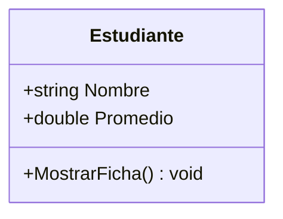
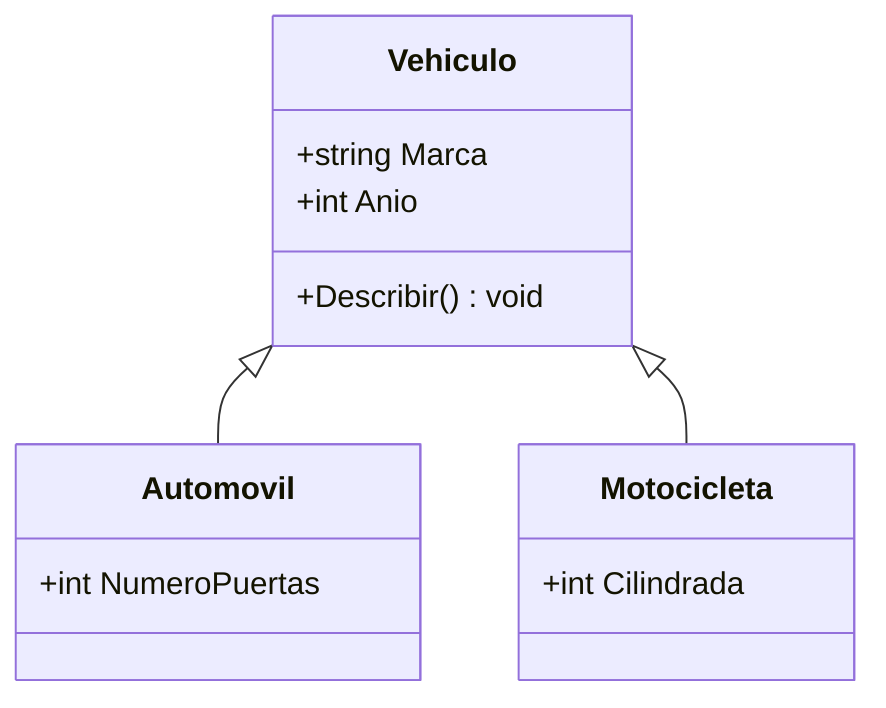
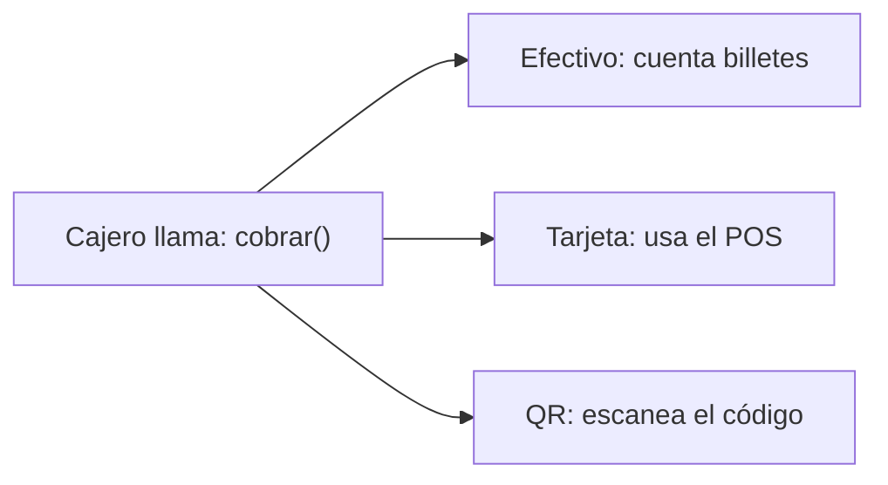
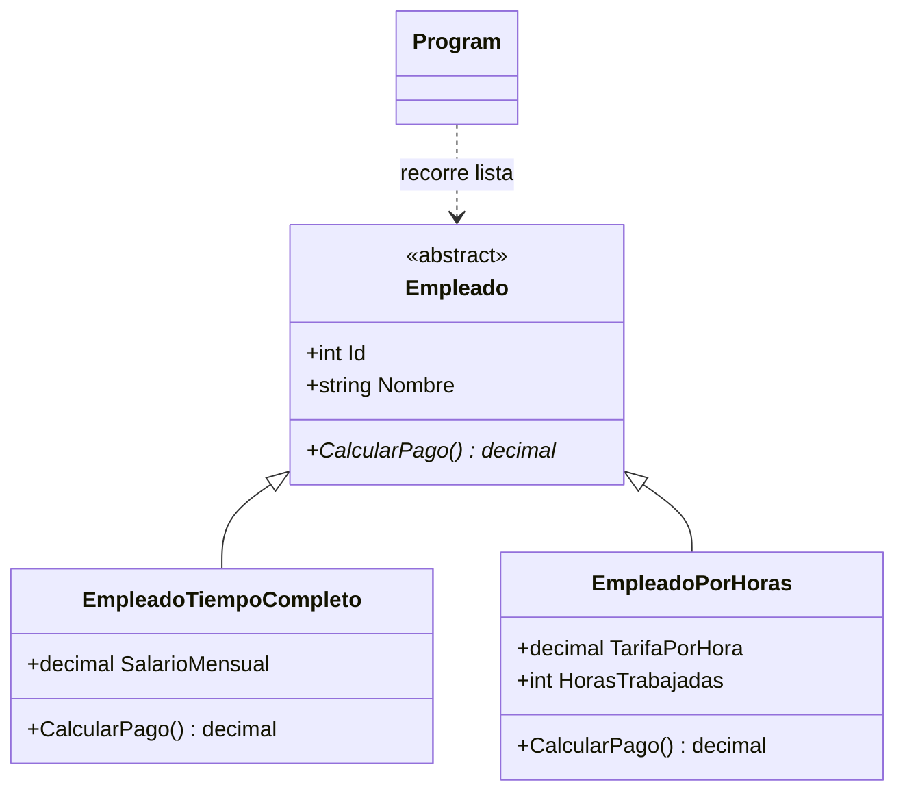

# Tema 7. Programación Orientada a Objetos y Desarrollo de Interfaces Gráficas

> **Aprendizaje esperado:** Implementar herencia y polimorfismo en un programa orientado a objetos que modele un sistema real.

Este documento acompaña las diapositivas de la clase. Aquí encontrarás, bloque por bloque, los **conceptos**, **ejemplos en C#**, **errores frecuentes**, **buenas prácticas** y **ejercicios** para practicar por tu cuenta.

---

## Índice

- [Cómo usar este material](#cómo-usar-este-material)
- [Bloque 1. Fundamentos de POO](#bloque-1-fundamentos-de-poo)
  - [1.1 ¿Qué es la Programación Orientada a Objetos?](#11-qué-es-la-programación-orientada-a-objetos)
  - [1.2 Clases y objetos](#12-clases-y-objetos)
  - [1.3 Atributos, variables y constantes](#13-atributos-variables-y-constantes)
  - [1.4 Métodos](#14-métodos)
  - [1.5 Constructores](#15-constructores)
  - [1.6 Encapsulación: getters y setters](#16-encapsulación-getters-y-setters)
  - [1.7 Todo junto: la clase Estudiante](#17-todo-junto-la-clase-estudiante)
  - [Ejercicios del Bloque 1](#ejercicios-del-bloque-1)
- [Bloque 2. Herencia](#bloque-2-herencia)
  - [2.1 Concepto de herencia y ventajas](#21-concepto-de-herencia-y-ventajas)
  - [2.2 Clase base y clases derivadas](#22-clase-base-y-clases-derivadas)
  - [2.3 Ejemplo: Vehiculo, Automovil y Motocicleta](#23-ejemplo-vehiculo-automovil-y-motocicleta)
  - [2.4 Sintaxis de herencia en C#](#24-sintaxis-de-herencia-en-c)
  - [2.5 Modificadores public, private y protected](#25-modificadores-public-private-y-protected)
  - [2.6 Constructores y uso de base](#26-constructores-y-uso-de-base)
  - [Ejercicios del Bloque 2](#ejercicios-del-bloque-2)
- [Bloque 3. Polimorfismo](#bloque-3-polimorfismo)
  - [3.1 Concepto de polimorfismo](#31-concepto-de-polimorfismo)
  - [3.2 Métodos virtual y override](#32-métodos-virtual-y-override)
  - [3.3 Sobrecarga vs. sobrescritura](#33-sobrecarga-vs-sobrescritura)
  - [3.4 Polimorfismo con referencias de tipo base](#34-polimorfismo-con-referencias-de-tipo-base)
  - [3.5 Clases y métodos abstract](#35-clases-y-métodos-abstract)
  - [3.6 List&lt;T&gt; con diferentes clases derivadas](#36-listt-con-diferentes-clases-derivadas)
  - [Ejercicios del Bloque 3](#ejercicios-del-bloque-3)
- [Bloque 4. Caso práctico: gestión de empleados](#bloque-4-caso-práctico-gestión-de-empleados)
  - [4.1 Planteamiento](#41-planteamiento)
  - [4.2 Diagrama UML](#42-diagrama-uml)
  - [4.3 Implementación en C#](#43-implementación-en-c)
  - [4.4 Ejecución y explicación del resultado](#44-ejecución-y-explicación-del-resultado)
  - [4.5 Ejercicio práctico](#45-ejercicio-práctico)
- [Conexión con interfaces gráficas (Windows Forms y WPF)](#conexión-con-interfaces-gráficas-windows-forms-y-wpf)
- [Resumen del tema](#resumen-del-tema)
- [Preguntas de repaso](#preguntas-de-repaso)
- [Tabla de errores frecuentes](#tabla-de-errores-frecuentes)
- [Glosario](#glosario)

---

## Cómo usar este material

**Requisitos:** tener instalado el [SDK de .NET](https://dotnet.microsoft.com/download) (versión 8 o superior) y un editor como Visual Studio, Visual Studio Code o Rider.

Para probar cualquier ejemplo, crea un proyecto de consola:

```bash
dotnet new console -o PruebaPOO
cd PruebaPOO
dotnet run
```

Pega el código en `Program.cs` y ejecútalo. Estos ejemplos asumen `ImplicitUsings` activado (es el valor por defecto desde .NET 6), por lo que no hace falta escribir `using System;` ni `using System.Collections.Generic;`.

> **Recomendación:** no copies y pegues todo. Escribe el código tú mismo, cambia valores, rompe cosas a propósito y lee los mensajes de error del compilador. Así se aprende.

**Nota sobre `Program.cs`:** cuando uses instrucciones de nivel superior (código suelto, sin `Main`), las declaraciones de clases deben ir **después** de esas instrucciones o en archivos separados.

---

# Bloque 1. Fundamentos de POO

> **Relación con el aprendizaje esperado:** antes de heredar y sobrescribir, necesitas saber construir una clase completa y bien protegida.

## 1.1 ¿Qué es la Programación Orientada a Objetos?

La **Programación Orientada a Objetos (POO)** es un paradigma que modela el software como **objetos** que combinan **datos** (lo que el objeto *sabe*) y **comportamiento** (lo que el objeto *sabe hacer*).

| Pilar | Idea central |
|---|---|
| **Abstracción** | Representar solo lo esencial del problema |
| **Encapsulación** | Proteger el estado interno y exponer una interfaz controlada |
| **Herencia** | Reutilizar y extender una clase existente |
| **Polimorfismo** | Un mismo mensaje, distintos comportamientos |

**Analogía:** un cajero automático tiene datos (saldo, tarjeta) y acciones (retirar, depositar). Tú no ves cómo funciona por dentro: eso es encapsulación.

En este tema nos enfocamos en **herencia** y **polimorfismo**.

> **Piensa:** ¿Qué objeto de tu vida diaria modelarías como clase? ¿Qué datos y qué acciones tendría?

---

## 1.2 Clases y objetos

- **Clase:** plano o molde que define qué datos y qué acciones tendrán los objetos.
- **Objeto:** instancia concreta creada a partir de una clase.

**Analogía:** el plano de una casa es la clase; cada casa construida con ese plano es un objeto. Con un plano puedes construir muchas casas, y cada una tiene sus propios muebles.



```csharp
public class Estudiante
{
    public string Nombre = "";
    public double Promedio;

    public void MostrarFicha() =>
        Console.WriteLine($"{Nombre}: {Promedio}");
}
```

Uso de la clase:

```csharp
Estudiante e1 = new Estudiante();
e1.Nombre = "Ana";
e1.Promedio = 85;
e1.MostrarFicha();   // Ana: 85

Estudiante e2 = new Estudiante();
e2.Nombre = "Luis";
e2.Promedio = 60;
e2.MostrarFicha();   // Luis: 60
```

**Puntos clave**

- `new` crea un objeto en memoria.
- Cada objeto tiene **sus propios datos**: cambiar `e1` no afecta a `e2`.
- Esta primera versión usa miembros `public` solo para entender el concepto. En la sección 1.6 veremos por qué conviene protegerlos.

---

## 1.3 Atributos, variables y constantes

| Elemento | Dónde vive | ¿Cambia? |
|---|---|---|
| **Atributo (campo)** | Dentro de la clase | Sí, por objeto |
| **Variable local** | Dentro de un método | Sí, mientras dure el método |
| **Constante (`const`)** | Dentro de la clase | Nunca |
| **`readonly`** | Dentro de la clase | Solo en la declaración o en el constructor |

```csharp
public class Estudiante
{
    public const double NotaMinima = 51.0;   // constante: igual para todos
    private readonly string _codigo;         // se asigna una sola vez
    private string _nombre = "";             // atributo
    private double _promedio;                // atributo

    public Estudiante(string codigo)
    {
        _codigo = codigo;
    }

    public bool EstaAprobado()
    {
        double nota = _promedio;             // variable local
        return nota >= NotaMinima;
    }
}

// La constante pertenece a la clase:
// Console.WriteLine(Estudiante.NotaMinima);
```

**Puntos clave**

- Los **atributos** son el estado del objeto y viven mientras viva el objeto.
- Una **variable local** nace y muere dentro del método; fuera de él no existe.
- `const` se fija en tiempo de compilación y se accede con el nombre de la clase (`Estudiante.NotaMinima`).
- `readonly` permite asignar el valor una sola vez (en la declaración o en el constructor).
- **Convención:** los campos privados suelen escribirse con guion bajo (`_nombre`).

> **Piensa:** ¿La nota mínima de aprobación debería ser distinta para cada estudiante? ¿Y el código del estudiante, debería poder cambiar después de creado?

---

## 1.4 Métodos

Un **método** es un bloque de código con nombre que define una acción del objeto.

**Anatomía de un método**

```text
modificador  tipoRetorno  Nombre(parámetros)
public       bool         EstaAprobado()
```

- `void`: realiza una acción y **no devuelve** valor.
- Con tipo de retorno (`bool`, `int`, `double`...): devuelve un resultado mediante `return`.
- Los **parámetros** son los datos que el método recibe.

```csharp
// Dentro de la clase Estudiante
public void SubirPromedio(double puntos)
{
    _promedio += puntos;
}

public bool EstaAprobado()
{
    return _promedio >= NotaMinima;
}

public double Faltante(double meta) => meta - _promedio;   // forma abreviada
```

Uso:

```csharp
e1.SubirPromedio(5);
bool ok = e1.EstaAprobado();
```

**Buena práctica:** nombres de métodos con **verbo** y en **PascalCase** (`CalcularPago`, `MostrarFicha`).

**Error frecuente:** olvidar `return` en un método con tipo de retorno distinto de `void` → error **CS0161**.

---

## 1.5 Constructores

Un **constructor** es un método especial que se ejecuta **al crear** el objeto y deja su estado inicial listo.

- Tiene el **mismo nombre** que la clase.
- **No tiene tipo de retorno** (ni siquiera `void`).
- Puede haber varios con distintos parámetros.
- `this(...)` permite reutilizar otro constructor de la misma clase.

```csharp
public Estudiante(string codigo, string nombre, double promedio)
{
    _codigo = codigo;
    _nombre = nombre;
    _promedio = promedio;
}

public Estudiante(string codigo, string nombre)
    : this(codigo, nombre, 0.0) { }
```

```csharp
var e1 = new Estudiante("E-01", "Ana", 85);
var e2 = new Estudiante("E-02", "Luis");   // promedio inicial: 0.0
```

**Puntos clave**

- Un objeto debe nacer **siempre válido**: el constructor garantiza los datos mínimos.
- Aquí se puede asignar un campo `readonly`.
- Tener dos constructores con distintos parámetros es un caso de **sobrecarga** (lo veremos en la sección 3.3).

**Error frecuente:** si defines un constructor con parámetros, **ya no existe** el constructor sin parámetros. Escribir `new Estudiante()` produce el error **CS7036**.

---

## 1.6 Encapsulación: getters y setters

**Encapsulación:** ocultar el estado interno del objeto y permitir el acceso solo mediante reglas.

- **Getter:** lee el valor.
- **Setter:** modifica el valor, normalmente con validación.
- En C# se implementan con **propiedades**.

**Analogía:** la bóveda de un banco. No entras directo; pasas por una ventanilla que verifica reglas. El *setter* es esa ventanilla.

### Propiedades automáticas

```csharp
public string Codigo { get; }              // solo lectura (se asigna en el constructor)
public string Nombre { get; set; } = "";   // lectura y escritura
```

Úsalas cuando no hay reglas que validar.

### Forma tradicional (con métodos)

```csharp
public double GetPromedio() => _promedio;
public void SetPromedio(double valor) { _promedio = valor; }
```

### Forma de C# (propiedad con validación)

```csharp
public double Promedio
{
    get => _promedio;
    set
    {
        if (value < 0 || value > 100)
            throw new ArgumentOutOfRangeException(nameof(value));
        _promedio = value;
    }
}
```

`value` es la palabra clave que representa el valor que se está asignando.

**Error frecuente:** dejar campos `public` y permitir cosas como `Promedio = -500`.

---

## 1.7 Todo junto: la clase Estudiante

```csharp
public class Estudiante
{
    public const double NotaMinima = 51.0;
    private double _promedio;

    public string Codigo { get; }
    public string Nombre { get; set; }

    public double Promedio
    {
        get => _promedio;
        set
        {
            if (value < 0 || value > 100)
                throw new ArgumentOutOfRangeException(nameof(value));
            _promedio = value;
        }
    }

    public Estudiante(string codigo, string nombre, double promedio)
    {
        Codigo = codigo;
        Nombre = nombre;
        Promedio = promedio;   // pasa por el setter, así también se valida aquí
    }

    public bool EstaAprobado() => Promedio >= NotaMinima;
}
```

Uso:

```csharp
var ana = new Estudiante("E-01", "Ana", 85);
Console.WriteLine(ana.EstaAprobado());   // True

ana.Promedio = 40;
Console.WriteLine(ana.EstaAprobado());   // False

// ana.Promedio = 150;   // lanza ArgumentOutOfRangeException
```

| Elemento | Dónde está en el código |
|---|---|
| Constante | `NotaMinima` |
| Atributo | `_promedio` |
| Propiedades (getters/setters) | `Codigo`, `Nombre`, `Promedio` |
| Constructor | `Estudiante(...)` |
| Método | `EstaAprobado()` |

> **Detalle importante:** en el constructor se asigna `Promedio` (la propiedad), no `_promedio`. Así la validación también se aplica al crear el objeto.

---

## Ejercicios del Bloque 1

**Ejercicio 1.1: Clase y objetos.** Crea la clase `Libro` con los atributos `Titulo`, `Autor` y `Paginas` y un método `MostrarFicha()` que imprima los datos. Crea dos objetos distintos y comprueba que son independientes.

**Ejercicio 1.2: Constantes y `readonly`.** Crea la clase `Producto` con:
- una constante `IVA = 0.13m`,
- un campo `readonly` para el código,
- un atributo `_precio`,
- un método `PrecioConIva()` que devuelva el precio más el impuesto.

**Ejercicio 1.3: Constructores.** Agrega a `Producto` dos constructores: uno con código, nombre y precio, y otro solo con código y nombre (el precio inicial es 0). El segundo debe usar `this(...)`.

**Ejercicio 1.4: Encapsulación.** Haz que la propiedad `Precio` de `Producto` rechace valores negativos lanzando una excepción. Comprueba qué ocurre al intentar `producto.Precio = -10;`.

**Ejercicio 1.5: Cuenta bancaria.** Crea la clase `CuentaBancaria` con titular de solo lectura, saldo protegido y los métodos `Depositar(decimal)` y `Retirar(decimal)`. No se debe poder retirar más de lo que hay ni depositar montos menores o iguales a cero.

<details>
<summary>Pistas</summary>

- En 1.2 recuerda que `decimal` usa el sufijo `m` (`0.13m`).
- En 1.4 la validación va en el `set` de la propiedad.
- En 1.5 el saldo debe ser un campo `private` expuesto con una propiedad de solo lectura (`public decimal Saldo => _saldo;`).

</details>

---

# Bloque 2. Herencia

> **Relación con el aprendizaje esperado:** este bloque es el **primer paso** para implementar herencia en un sistema real.

## 2.1 Concepto de herencia y ventajas

**Herencia:** mecanismo por el cual una clase (la **derivada**) reutiliza los miembros de otra (la **base**) y los extiende con los suyos.

**Analogía:** un hijo hereda rasgos de sus padres, pero también tiene los suyos propios.

**Ventajas**

| Ventaja | Qué significa |
|---|---|
| Reutilización de código | Lo común se escribe una sola vez |
| Jerarquías claras | El modelo refleja relaciones del mundo real |
| Mantenimiento centralizado | Corriges un error en la base y todas las derivadas se benefician |
| Extensibilidad | Agregar un tipo nuevo no obliga a reescribir lo existente |

> **Advertencia:** hereda solo cuando exista una relación real **"es un"**. Si la relación es **"tiene un"**, usa composición.

---

## 2.2 Clase base y clases derivadas

| Término | Sinónimos | Rol |
|---|---|---|
| **Clase base** | superclase, clase padre | Define lo común |
| **Clase derivada** | subclase, clase hija | Reutiliza y especializa |

### Prueba "es un"

- ✔ Un `Automovil` **es un** `Vehiculo` → herencia.
- ✘ Un `Vehiculo` **tiene un** `Motor` → composición, no herencia.

### Datos importantes en C#

- Una clase hereda de **una sola** clase base (no hay herencia múltiple de clases).
- Toda clase deriva, directa o indirectamente, de `object`.
- En Windows Forms, `Button` y `TextBox` derivan de `Control`.

**Buena práctica:** crea jerarquías poco profundas. Más de 3 o 4 niveles suele indicar un mal diseño.

> **Piensa:** ¿Un `Cuadrado` es un `Rectángulo`? ¿Una `Pila` es una `Lista`? La herencia debe respetar el comportamiento que se espera de la clase base.

---

## 2.3 Ejemplo: Vehiculo, Automovil y Motocicleta



**Cómo leer el diagrama**

- La flecha con triángulo vacío significa **"hereda de"**.
- `Marca` y `Anio` están escritos en un solo lugar (la base).
- Cada derivada agrega **solo lo propio**: `Automovil` → puertas, `Motocicleta` → cilindrada.

Sin herencia tendríamos `Marca` y `Anio` duplicados en cada clase.

> **Piensa:** ¿Qué otras clases derivadas podría tener `Vehiculo`? (`Camion`, `Autobus`...)

---

## 2.4 Sintaxis de herencia en C#

```csharp
public class Vehiculo
{
    public string Marca { get; set; } = "";
    public int Anio { get; set; }

    public void Describir() =>
        Console.WriteLine($"{Marca} ({Anio})");
}

public class Automovil : Vehiculo
{
    public int NumeroPuertas { get; set; }
}

public class Motocicleta : Vehiculo
{
    public int Cilindrada { get; set; }
}
```

Uso:

```csharp
var auto = new Automovil
{
    Marca = "Toyota",
    Anio = 2022,
    NumeroPuertas = 4
};

auto.Describir();   // Toyota (2022)
```

**Puntos clave**

- La sintaxis es `class Derivada : Base`; los dos puntos significan "hereda de".
- `Marca`, `Anio` y `Describir()` son **heredados**: `Automovil` nunca los declaró, pero puede usarlos.
- Esta es la versión inicial, todavía sin constructores (se agregan en la sección 2.6).

---

## 2.5 Modificadores public, private y protected

| Modificador | Es visible en |
|---|---|
| `public` | Cualquier clase |
| `private` | Solo la propia clase |
| `protected` | La propia clase y sus derivadas |

```csharp
public class Vehiculo
{
    public string Marca { get; set; } = "";
    private string _numeroChasis = "";
    protected int Velocidad { get; set; }
}

public class Automovil : Vehiculo
{
    public void Acelerar()
    {
        Marca = "Toyota";        // OK: public
        Velocidad += 10;         // OK: protected
        // _numeroChasis = "X1"; // Error CS0122: es private en Vehiculo
    }
}
```

**Puntos clave**

- Los miembros `private` **sí existen** en el objeto derivado, pero la clase derivada no puede acceder a ellos por nombre.
- C# también tiene `internal` y `protected internal`; no los usamos en este tema.

**Buena práctica:** campos `private`, acceso mediante propiedades y `protected` solo cuando las derivadas realmente lo necesiten.

---

## 2.6 Constructores y uso de base

```csharp
public class Vehiculo
{
    public string Marca { get; }
    public int Anio { get; }

    public Vehiculo(string marca, int anio)
    {
        Marca = marca;
        Anio = anio;
    }
}

public class Automovil : Vehiculo
{
    public int NumeroPuertas { get; }

    public Automovil(string marca, int anio, int numeroPuertas)
        : base(marca, anio)
    {
        NumeroPuertas = numeroPuertas;
    }
}
```

**Reglas clave**

1. Los constructores **no se heredan**.
2. `: base(...)` invoca el constructor de la clase base.
3. Primero se ejecuta el constructor de la **base** y luego el de la **derivada**.

**Analogía:** antes de construir el segundo piso hay que construir los cimientos.

**Error frecuente:** omitir `: base(marca, anio)` cuando la base **no** tiene constructor sin parámetros → error **CS7036**. Si la base tuviera un constructor sin parámetros, C# lo llamaría automáticamente.

---

## Ejercicios del Bloque 2

**Ejercicio 2.1: Prueba "es un".** Indica si cada relación debe modelarse con herencia o con composición y justifica:
a) `Gato` y `Animal`
b) `Casa` y `Puerta`
c) `Docente` y `Persona`
d) `Computadora` y `Procesador`

**Ejercicio 2.2: Primera jerarquía.** Crea la clase base `Animal` con `Nombre` y `Edad`, y las derivadas `Perro` (con `Raza`) y `Gato` (con `EsDomestico`). Cada clase debe tener constructor y usar `: base(...)`.

**Ejercicio 2.3: `protected`.** En `Animal`, agrega un campo `protected int _energia` inicializado en 100. En `Perro`, crea un método `Correr()` que reduzca la energía en 10. Intenta acceder a `_energia` desde `Program` y observa el error.

**Ejercicio 2.4: Encuentra el error.** Explica por qué no compila:

```csharp
public class Persona
{
    public string Nombre { get; }
    public Persona(string nombre) { Nombre = nombre; }
}

public class Docente : Persona
{
    public string Materia { get; }
    public Docente(string nombre, string materia)
    {
        Materia = materia;
    }
}
```

**Ejercicio 2.5: Tu propia jerarquía.** Diseña una jerarquía de al menos tres clases (por ejemplo `Dispositivo` → `Telefono` y `Laptop`), dibuja su diagrama de clases e impleméntala en C#.

<details>
<summary>Pistas</summary>

- 2.1: aplica la prueba "es un" frente a "tiene un".
- 2.4: mira qué constructor busca `Docente` en `Persona`. ¿Qué línea falta?

</details>

---

# Bloque 3. Polimorfismo

> **Relación con el aprendizaje esperado:** el polimorfismo es el **segundo pilar** que debes dominar para modelar sistemas reales.

## 3.1 Concepto de polimorfismo

**Polimorfismo** significa "muchas formas": el emisor envía **el mismo mensaje** y **cada objeto responde a su manera**.

**Analogía cotidiana:** en una tienda, el cajero dice "cobrar" y el efecto depende del medio de pago. El cajero no escribe un `if` distinto por cada medio.



En código, queremos llamar al mismo método **sin preguntar por el tipo concreto** del objeto.

---

## 3.2 Métodos virtual y override

- `virtual` en la **base**: "este método se puede redefinir".
- `override` en la **derivada**: "aquí está mi versión".
- Ambos métodos deben tener la **misma firma**.

```csharp
public class Vehiculo
{
    public string Marca { get; }
    public int Anio { get; }

    public Vehiculo(string marca, int anio)
    {
        Marca = marca;
        Anio = anio;
    }

    public virtual void Describir()
        => Console.WriteLine($"Vehículo: {Marca} ({Anio})");
}

public class Automovil : Vehiculo
{
    public int NumeroPuertas { get; }

    public Automovil(string marca, int anio, int puertas)
        : base(marca, anio) { NumeroPuertas = puertas; }

    public override void Describir()
        => Console.WriteLine($"Automóvil: {Marca} ({Anio}), {NumeroPuertas} puertas");
}

public class Motocicleta : Vehiculo
{
    public int Cilindrada { get; }

    public Motocicleta(string marca, int anio, int cc)
        : base(marca, anio) { Cilindrada = cc; }

    public override void Describir()
        => Console.WriteLine($"Motocicleta: {Marca} ({Anio}), {Cilindrada} cc");
}
```

**Puntos clave**

- La derivada puede llamar a `base.Describir()` dentro de su `override` si quiere reutilizar la versión de la base.
- **Analogía:** la base ofrece un formulario con campos opcionales (`virtual`); la derivada decide si lo rellena con su propia versión (`override`).

**Error frecuente:** usar `override` sin que la base tenga el método marcado como `virtual`, `abstract` u `override` → error **CS0506**.

---

## 3.3 Sobrecarga vs. sobrescritura

Son dos conceptos distintos que suelen confundirse.

| | **Sobrecarga (overload)** | **Sobrescritura (override)** |
|---|---|---|
| Dónde ocurre | En la **misma clase** | En una **clase derivada** |
| Nombre | El mismo | El mismo |
| Parámetros | **Distintos** | **Idénticos** (misma firma) |
| ¿Requiere herencia? | No | Sí, y `virtual`/`abstract` en la base |
| Se resuelve en | **Compilación** | **Ejecución** |

### Ejemplo de sobrecarga

```csharp
public class Calculadora
{
    public int Sumar(int a, int b) => a + b;
    public double Sumar(double a, double b) => a + b;
    public int Sumar(int a, int b, int c) => a + b + c;
}
```

### Ejemplo de sobrescritura

```csharp
public class Animal
{
    public virtual string Hablar() => "...";
}

public class Perro : Animal
{
    public override string Hablar() => "Guau";
}
```

**Truco para recordar:** la **sobre*carga*** pone varias versiones en la misma clase con distintos parámetros; la **sobre*escritura*** hace que la derivada "escriba encima" la versión de la base.

**Error frecuente:** llamar "sobrecarga" a una redefinición en la clase derivada. Si hay herencia y la firma coincide, es **sobrescritura**.

> **Piensa:** ¿Cambiar solo el tipo de retorno basta para sobrecargar un método? **No:** la sobrecarga depende de la lista de parámetros.

---

## 3.4 Polimorfismo con referencias de tipo base

Una variable del tipo de la **base** puede apuntar a un objeto de cualquier **derivada**.

```csharp
Vehiculo v1 = new Automovil("Toyota", 2022, 4);
Vehiculo v2 = new Motocicleta("Yamaha", 2021, 250);

v1.Describir();   // Automóvil: Toyota (2022), 4 puertas
v2.Describir();   // Motocicleta: Yamaha (2021), 250 cc

// v1.NumeroPuertas;   // Error: el tipo estático es Vehiculo
if (v1 is Automovil a)
    Console.WriteLine(a.NumeroPuertas);   // 4
```

| Concepto | Significado | En el ejemplo |
|---|---|---|
| **Tipo estático** | El tipo declarado en la variable | `Vehiculo` |
| **Tipo real** | El tipo del objeto creado | `Automovil` |

El método que se ejecuta depende del **tipo real**. Para acceder a miembros propios de la derivada se usa el patrón `is`.

**Analogía:** un control remoto universal. Aprietas "encender" y cada aparato responde distinto, aunque el control solo conoce el botón.

---

## 3.5 Clases y métodos abstract

Una **clase abstracta** define un contrato pero no puede instanciarse. Un **método abstracto** solo declara la firma, sin cuerpo.

```csharp
public abstract class Figura
{
    public abstract double Area();   // sin cuerpo

    public void Mostrar()            // con cuerpo
        => Console.WriteLine($"Área: {Area():F2}");
}

public class Circulo : Figura
{
    public double Radio { get; }

    public Circulo(double radio) => Radio = radio;

    public override double Area() => Math.PI * Radio * Radio;
}
```

**Reglas**

- No se puede instanciar: `new Figura()` produce el error **CS0144**.
- Un método `abstract` solo declara la firma.
- La derivada concreta **debe** hacer `override` de cada método abstracto.
- Una clase abstracta puede tener constructores, propiedades y métodos concretos.

**Analogía:** "mamífero" es un concepto útil, pero nunca encuentras un animal que sea solo "mamífero" sin ser una especie concreta.

**Buena práctica:** usa `abstract` cuando la base define un contrato pero no puede dar una implementación razonable.

---

## 3.6 List&lt;T&gt; con diferentes clases derivadas

```csharp
List<Vehiculo> flota = new()
{
    new Automovil("Toyota", 2022, 4),
    new Motocicleta("Yamaha", 2021, 250),
    new Automovil("Kia", 2023, 5)
};

foreach (Vehiculo v in flota)
    v.Describir();
```

Salida:

```text
Automóvil: Toyota (2022), 4 puertas
Motocicleta: Yamaha (2021), 250 cc
Automóvil: Kia (2023), 5 puertas
```

**Puntos clave**

- Una sola colección guarda objetos de **distintos tipos derivados**.
- El mismo `foreach` funciona **sin `if` por tipo**.
- Agregar un `Camion` no obliga a modificar el recorrido.

**Sin polimorfismo** habría que escribir algo así, y cada tipo nuevo obligaría a editar este bloque:

```csharp
if (v is Automovil) { /* ... */ }
else if (v is Motocicleta) { /* ... */ }
```

**Buena práctica:** declara la lista con el tipo base (`List<Vehiculo>`).

**Error frecuente:** pensar que `List<Automovil>` se puede usar como `List<Vehiculo>`. No son intercambiables.

---

## Ejercicios del Bloque 3

**Ejercicio 3.1: Clasifica.** Indica si cada caso es sobrecarga o sobrescritura:

| Caso | ¿Sobrecarga o sobrescritura? |
|---|---|
| a) `Imprimir(string)` e `Imprimir(int)` en la misma clase | |
| b) `Perro` redefine `Hablar()` de `Animal` marcado `virtual` | |
| c) Dos constructores con distintos parámetros | |
| d) `Circulo` implementa `Area()` abstracto de `Figura` | |

**Ejercicio 3.2: `virtual` y `override`.** Al ejemplo `Animal` / `Perro`, agrega la clase `Gato` (que responde `"Miau"`) y `Vaca` (que responde `"Muu"`). Guarda un objeto de cada uno en un `List<Animal>` y recórrelo llamando a `Hablar()`.

**Ejercicio 3.3: Clase abstracta.** Completa la jerarquía de `Figura` con `Rectangulo` (base y altura) y `Triangulo` (base y altura). Crea una `List<Figura>`, recórrela mostrando el área de cada una y calcula la suma total.

**Ejercicio 3.4: `base.Metodo()`.** En el ejemplo de `Vehiculo`, modifica `Automovil.Describir()` para que llame primero a `base.Describir()` y luego imprima el número de puertas. Observa la salida.

**Ejercicio 3.5: Errores a propósito.** Provoca y documenta cada uno de estos errores del compilador:
a) `new Figura()` con `Figura` abstracta
b) `override` sin `virtual` en la base
c) Una derivada concreta que no implementa un método abstracto

**Ejercicio 3.6: Tu propio sistema.** Modela un sistema de pagos con una clase abstracta `MedioPago` y las derivadas `Efectivo`, `TarjetaCredito` y `PagoQr`. Cada una calcula una comisión distinta mediante un método abstracto `CalcularComision(decimal monto)`.

<details>
<summary>Respuestas del ejercicio 3.1</summary>

a) Sobrecarga · b) Sobrescritura · c) Sobrecarga · d) Sobrescritura (implementación de un método abstracto mediante `override`).

</details>

---

# Bloque 4. Caso práctico: gestión de empleados

> **Relación con el aprendizaje esperado:** aquí se integran herencia, clases abstractas y polimorfismo en un sistema que modela un caso real.

## 4.1 Planteamiento

Una empresa paga a su personal de dos maneras distintas y necesita calcular la **nómina total**.

**Reglas de negocio**

- Todo empleado tiene `Id` y `Nombre`.
- **Tiempo completo:** pago = salario mensual.
- **Por horas:** pago = horas trabajadas × tarifa por hora.
- El sistema recorre una lista y llama a `CalcularPago()` **sin preguntar el tipo**.

**Clases del sistema**

| Clase | Rol |
|---|---|
| `Empleado` | Clase base **abstracta** |
| `EmpleadoTiempoCompleto` | Calcula el salario mensual |
| `EmpleadoPorHoras` | Calcula el pago según horas y tarifa |

> **Piensa:** ¿Cómo agregarías un tercer tipo de empleado **sin modificar** el código ya escrito?

Una nómina nunca tiene un "empleado genérico": siempre hay un tipo concreto con su regla de cálculo. Por eso `Empleado` es abstracta.

---

## 4.2 Diagrama UML



**Lectura del diagrama**

- `Empleado` define el contrato (`CalcularPago`); las dos derivadas lo implementan con su propia fórmula.
- `Program` depende solo de `Empleado`, no de las clases concretas. Ese es el beneficio del polimorfismo en el diseño.
- Un futuro `EmpleadoPorComision` se dibujaría como una tercera flecha desde `Empleado`.

---

## 4.3 Implementación en C#

Crea un proyecto de consola y pega este código completo en `Program.cs`. Las instrucciones de nivel superior van primero y las clases al final.

```csharp
// ===== Programa principal =====
List<Empleado> empleados = new()
{
    new EmpleadoTiempoCompleto(1, "Ana Torres", 3200m),
    new EmpleadoPorHoras(2, "Luis Mamani", 45m, 120),
    new EmpleadoPorHoras(3, "Carla Rojas", 38.5m, 80)
};

decimal total = 0m;

foreach (Empleado e in empleados)
{
    decimal pago = e.CalcularPago();   // polimorfismo: se ejecuta la versión del tipo real
    total += pago;
    Console.WriteLine($"{e.Id} | {e.Nombre,-12} | {e.GetType().Name,-22} | {pago,9:N2}");
}

Console.WriteLine($"Total nómina: {total:N2}");

// ===== Clases =====
public abstract class Empleado
{
    public int Id { get; }
    public string Nombre { get; }

    protected Empleado(int id, string nombre)
    {
        if (string.IsNullOrWhiteSpace(nombre))
            throw new ArgumentException("El nombre es obligatorio.", nameof(nombre));
        Id = id;
        Nombre = nombre;
    }

    public abstract decimal CalcularPago();
}

public class EmpleadoTiempoCompleto : Empleado
{
    public decimal SalarioMensual { get; }

    public EmpleadoTiempoCompleto(int id, string nombre, decimal salarioMensual)
        : base(id, nombre)
    {
        if (salarioMensual < 0)
            throw new ArgumentOutOfRangeException(nameof(salarioMensual));
        SalarioMensual = salarioMensual;
    }

    public override decimal CalcularPago() => SalarioMensual;
}

public class EmpleadoPorHoras : Empleado
{
    public decimal TarifaPorHora { get; }
    public int HorasTrabajadas { get; }

    public EmpleadoPorHoras(int id, string nombre, decimal tarifaPorHora, int horasTrabajadas)
        : base(id, nombre)
    {
        if (tarifaPorHora < 0)
            throw new ArgumentOutOfRangeException(nameof(tarifaPorHora));
        if (horasTrabajadas < 0)
            throw new ArgumentOutOfRangeException(nameof(horasTrabajadas));
        TarifaPorHora = tarifaPorHora;
        HorasTrabajadas = horasTrabajadas;
    }

    public override decimal CalcularPago() => TarifaPorHora * HorasTrabajadas;
}
```

### Explicación por partes

1. **`Empleado` (abstracta):**
   - Propiedades de solo lectura (`Id`, `Nombre`): encapsulación.
   - Constructor `protected`: solo las derivadas pueden invocarlo con `base`.
   - Método `abstract CalcularPago()`: cada derivada debe implementarlo.
2. **`EmpleadoTiempoCompleto`:** llama a `base(id, nombre)`, valida el salario y sobrescribe `CalcularPago()` devolviendo el salario mensual.
3. **`EmpleadoPorHoras`:** mismo patrón, pero la fórmula es `tarifa × horas`.
4. **`Program`:** crea una `List<Empleado>` y recorre con un solo `foreach`.

> **¿Por qué `decimal`?** Para dinero se usa `decimal`, que evita los errores de redondeo de `double` y `float`.

> **¿Por qué el constructor de `Empleado` es `protected`?** Porque la clase es abstracta y nadie puede instanciarla; solo las derivadas lo invocan mediante `base`.

---

## 4.4 Ejecución y explicación del resultado

Salida (con cultura en-US):

```text
1 | Ana Torres   | EmpleadoTiempoCompleto |  3,200.00
2 | Luis Mamani  | EmpleadoPorHoras       |  5,400.00
3 | Carla Rojas  | EmpleadoPorHoras       |  3,080.00
Total nómina: 11,680.00
```

**Verificación de los cálculos**

| Empleado | Tipo | Cálculo | Pago |
|---|---|---|---|
| Ana Torres | Tiempo completo | salario mensual | 3,200.00 |
| Luis Mamani | Por horas | 45 × 120 | 5,400.00 |
| Carla Rojas | Por horas | 38.5 × 80 | 3,080.00 |
| **Total** | | | **11,680.00** |

**Qué observar**

- El **tipo estático** de la variable `e` es siempre `Empleado`.
- El **tipo real** cambia en cada elemento de la lista.
- `e.CalcularPago()` ejecuta la versión correcta **sin ningún `if`**: el polimorfismo lo resuelve en tiempo de ejecución.

**Notas**

- El formato `N2` depende de la cultura del equipo. En español de Bolivia (`es-BO`) se vería `3.200,00`. Es normal que cambien los separadores.
- Si intentas `new Empleado(...)` el código **no compila**, porque la clase es abstracta.

---

## 4.5 Ejercicio práctico

**Extiende el sistema sin modificar el recorrido de la lista.**

1. Crea la clase `EmpleadoPorComision` que herede de `Empleado`.
2. Agrega `SalarioBase`, `VentasDelMes` y `PorcentajeComision` como propiedades encapsuladas.
3. Sobrescribe `CalcularPago()` con: **salario base + ventas × porcentaje**.
4. Valida los datos en el constructor y usa `: base(...)`.
5. Agrégala a `List<Empleado>` y comprueba el total.

**Reto opcional:** muestra la nómina en una interfaz gráfica (por ejemplo, un `ListBox` en Windows Forms o un `ListView` en WPF).

**Pregunta de reflexión:** ¿Qué líneas del programa principal tuviste que cambiar, además de agregar el nuevo empleado? *(La respuesta esperada es: ninguna.)*

**Criterio de logro:** el bucle `foreach` y la lista **no cambian**.

**Ejercicios adicionales**

- **4.5.1** Agrega a `Empleado` un método **virtual** `MostrarResumen()` que imprima `Id` y `Nombre`. Sobrescríbelo en una derivada para agregar más información usando `base.MostrarResumen()`.
- **4.5.2** Agrega una propiedad `decimal Bono` a `EmpleadoTiempoCompleto` y haz que `CalcularPago()` sume el bono.
- **4.5.3** Calcula y muestra cuántos empleados de cada tipo hay en la lista usando `is`.
- **4.5.4** Ordena la lista de empleados por pago de mayor a menor (pista: `OrderByDescending` de LINQ, con `using System.Linq;` si no está importado).
- **4.5.5** Aplica este mismo patrón a otro dominio: un sistema de **figuras**, **vehículos de una flota**, **productos de una tienda** o **cuentas bancarias** (ahorro y corriente).

---

# Conexión con interfaces gráficas (Windows Forms y WPF)

Los frameworks de interfaces gráficas están construidos con **herencia y polimorfismo**:

- En **Windows Forms**, `Button`, `TextBox` y `Label` derivan de `Control`.
- En **WPF**, `Button` deriva de `Control` y de `UIElement`.
- El framework trata a todos los elementos como `Control`, y cada uno se dibuja y responde a su manera. Es el mismo principio de la `List<Empleado>`.

Ejemplo en Windows Forms: un botón personalizado que sobrescribe su dibujo.

```csharp
// using System.Windows.Forms;
public class MiBoton : Button
{
    protected override void OnPaint(PaintEventArgs pevent)
    {
        base.OnPaint(pevent);
        // dibujo personalizado
    }
}
```

Fíjate en que se usan los mismos conceptos de este tema: herencia (`: Button`), `protected`, `override` y `base`.

**Idea para más adelante:** los datos de una `List<Empleado>` pueden mostrarse en un control gráfico (por ejemplo, un `ListBox`). Las clases del dominio siguen siendo las mismas; solo cambia cómo se presentan.

---

# Resumen del tema

| Concepto | Idea clave |
|---|---|
| **Clases y objetos** | La clase es el molde; el objeto es la instancia |
| **Encapsulación** | Estado `private`, acceso mediante propiedades con validación |
| **Constructores** | Dejan el objeto en un estado inicial válido |
| **Herencia** | `class Derivada : Base` reutiliza y extiende |
| **`protected` y `base`** | Acceso para derivadas y constructores encadenados |
| **`virtual` / `override`** | Permiten redefinir comportamiento |
| **`abstract`** | Define contratos sin poder instanciarse |
| **Polimorfismo** | Una `List<Empleado>` y un solo `foreach` |

**Ruta de aprendizaje:** Fundamentos → Herencia → Polimorfismo → Caso práctico → Interfaces gráficas.

---

# Preguntas de repaso

1. ¿Qué palabras clave permiten redefinir un método en una clase derivada?
2. ¿Por qué `new Empleado(...)` no compila?
3. ¿Qué diferencia hay entre sobrecarga y sobrescritura?
4. ¿Qué método se ejecuta si `Vehiculo v = new Automovil(...)` y llamas a `v.Describir()`?
5. ¿Cómo se relaciona `Button : Control` con el polimorfismo?
6. ¿Qué diferencia hay entre `const` y `readonly`?
7. ¿Por qué se asigna la propiedad y no el campo en el constructor de `Estudiante`?
8. ¿Cuándo conviene usar composición en lugar de herencia?

<details>
<summary>Ver respuestas</summary>

1. `virtual` (o `abstract`) en la base y `override` en la derivada.
2. Porque `Empleado` es abstracta; solo se instancian clases concretas.
3. Sobrecarga: mismo nombre y distintos parámetros en la misma clase, se resuelve al compilar. Sobrescritura: misma firma en una derivada, se resuelve en ejecución.
4. El de `Automovil`, porque el método ejecutado depende del tipo real del objeto.
5. `Button` es un `Control`; el framework puede tratar cualquier control como `Control` y cada uno sobrescribe su comportamiento, por ejemplo `OnPaint`.
6. `const` se fija en compilación y pertenece a la clase; `readonly` se asigna una sola vez (declaración o constructor) y puede ser distinto por objeto.
7. Para que la validación del setter también se aplique al crear el objeto.
8. Cuando la relación es "tiene un" y no "es un" (por ejemplo, un `Vehiculo` tiene un `Motor`).

</details>

---

# Tabla de errores frecuentes

| Error | Causa | Cómo corregirlo |
|---|---|---|
| **CS7036** | Falta `: base(...)` o se llama a un constructor sin parámetros que no existe | Agregar la llamada a `base(...)` o el constructor correspondiente |
| **CS0122** | Se accede a un miembro `private` (o inaccesible) | Cambiar la visibilidad a `protected`/`public` o usar una propiedad |
| **CS0506** | `override` sobre un método que no es `virtual`, `abstract` ni `override` | Marcar el método de la base como `virtual` |
| **CS0144** | Se intenta instanciar una clase abstracta | Instanciar una derivada concreta |
| **CS0161** | Un método con tipo de retorno no devuelve valor en todos los caminos | Agregar el `return` que falta |
| Campos `public` | Se rompe la encapsulación | Usar campos `private` y propiedades |
| Confundir sobrecarga y sobrescritura | Se mezclan "mismo nombre, distintos parámetros" y "misma firma en derivada" | Revisar la tabla de la sección 3.3 |
| `List<Hija>` como `List<Base>` | Las listas genéricas no son intercambiables | Declarar la lista con el tipo base |

---

# Glosario

| Término | Definición |
|---|---|
| **Clase** | Plano que define datos y comportamiento de los objetos |
| **Objeto** | Instancia concreta de una clase |
| **Atributo (campo)** | Variable que guarda el estado de un objeto |
| **Método** | Acción que puede realizar un objeto |
| **Constructor** | Método especial que inicializa el objeto al crearlo |
| **Propiedad** | Miembro con `get`/`set` que controla el acceso a un dato |
| **Encapsulación** | Ocultar el estado interno y exponer acceso controlado |
| **Herencia** | Reutilizar y extender una clase existente |
| **Clase base** | Clase de la que otras heredan |
| **Clase derivada** | Clase que hereda de una base |
| **`protected`** | Visible en la clase y en sus derivadas |
| **`base`** | Referencia a la clase base (constructor o miembros) |
| **Polimorfismo** | Un mismo mensaje con distintos comportamientos según el objeto |
| **`virtual`** | Método de la base que puede ser redefinido |
| **`override`** | Redefinición de un método `virtual` o `abstract` en una derivada |
| **Sobrecarga** | Varios métodos con el mismo nombre y distintos parámetros en una clase |
| **Sobrescritura** | Redefinir en la derivada un método de la base con la misma firma |
| **Clase abstracta** | Clase que no se puede instanciar y puede declarar miembros abstractos |
| **Tipo estático** | Tipo con el que se declara una variable |
| **Tipo real** | Tipo del objeto que realmente existe en memoria |
| **UML** | Lenguaje gráfico para representar el diseño de clases |

---

> **Consejo final:** la mejor forma de dominar herencia y polimorfismo es modelar sistemas reales (inventario, biblioteca, tienda). Elige uno, dibuja su diagrama de clases y prográmalo.