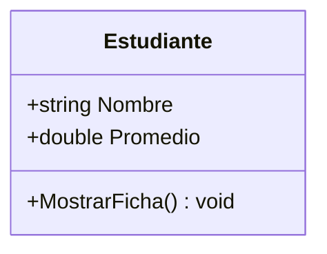
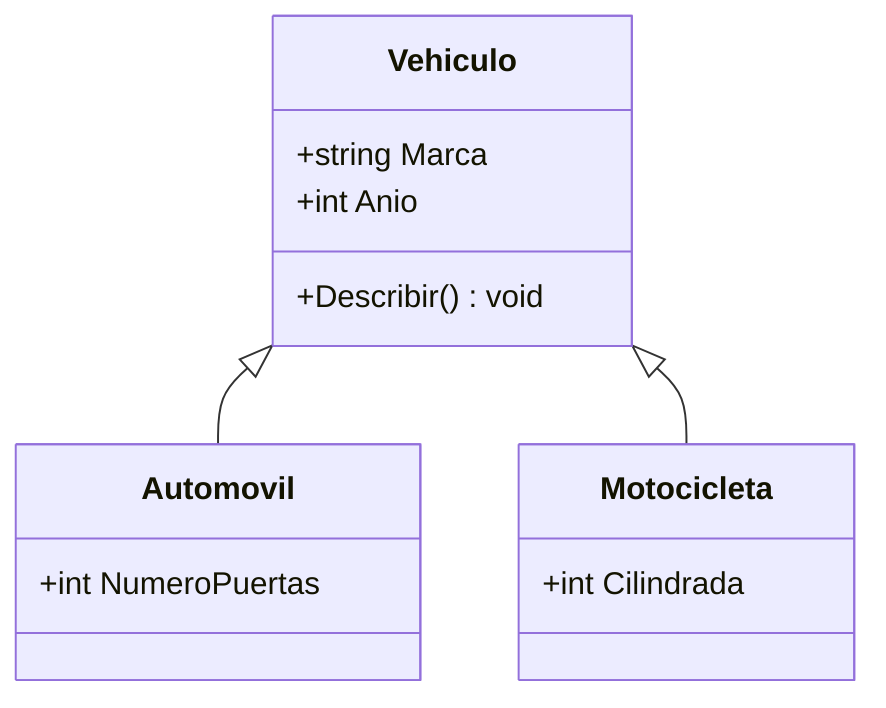
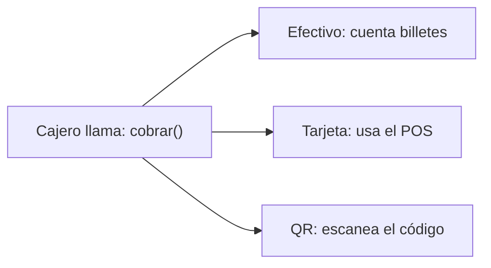
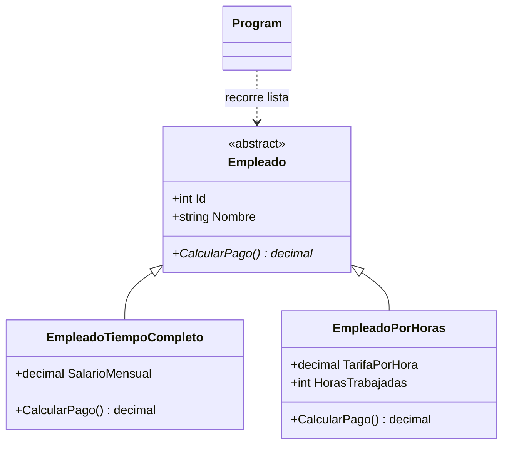

# Herencia y Polimorfismo en C#

Tema 7 · Programación Orientada a Objetos y Desarrollo de Interfaces Gráficas

<div class="mt-8 text-sm opacity-70">
Docente: [Tu nombre] · Programación Orientada a Objetos · C# y .NET
</div>

<!--
Bienvenida. Anuncia el hilo conductor de la clase: partimos de ejemplos cotidianos (vehículos, formas de pago) y terminamos con un sistema real de gestión de empleados.

Pregunta de apertura: "¿Cuántas veces han copiado y pegado código para crear una clase parecida a otra?" Esa incomodidad es la motivación de la herencia.
-->

---
class: 'bg-white'
---

# Aprendizaje esperado y objetivos

<div class="mt-4 p-4 rounded border-l-4 border-[#2F6BFF] bg-blue-50 text-gray-800">
<b>Aprendizaje esperado:</b> Implementar herencia y polimorfismo en un programa orientado a objetos que modele un sistema real.
</div>

## Al terminar la clase podrás

- Crear clases con atributos, métodos, constructores y propiedades (getters y setters)
- Explicar qué es la herencia y cuándo conviene usarla
- Usar `protected`, `base`, `virtual` y `override` correctamente
- Distinguir **sobrecarga** de **sobrescritura**
- Diseñar clases `abstract` y recorrer una `List<Empleado>` de forma polimórfica

## Ruta de la clase

<div class="grid grid-cols-4 gap-3 text-sm mt-2">
<div class="p-2 rounded border border-gray-300"><b>Bloque 1</b><br/>Fundamentos de POO</div>
<div class="p-2 rounded border border-[#2F6BFF]"><b>Bloque 2</b><br/>Herencia</div>
<div class="p-2 rounded border border-[#2F6BFF]"><b>Bloque 3</b><br/>Polimorfismo</div>
<div class="p-2 rounded border border-gray-300"><b>Bloque 4</b><br/>Caso práctico</div>
</div>

<!--
Los bloques 2 y 3 son el núcleo del aprendizaje esperado; el bloque 1 prepara el terreno y el bloque 4 integra todo en un sistema real.

Menciona que al final se conecta con Windows Forms y WPF: los controles gráficos son clases organizadas con herencia y polimorfismo.
-->

---

# ¿Qué es la Programación Orientada a Objetos?

Un paradigma que modela el software como **objetos** que combinan datos y comportamiento.

<div class="grid grid-cols-2 gap-4 mt-6 text-sm">
<div class="p-3 rounded border border-gray-300"><b>Abstracción</b><br/>Representar solo lo esencial del problema.</div>
<div class="p-3 rounded border border-gray-300"><b>Encapsulación</b><br/>Proteger el estado interno y exponer una interfaz controlada.</div>
<div class="p-3 rounded border-2 border-[#2F6BFF] bg-blue-50"><b>Herencia</b><br/>Reutilizar y extender una clase existente.</div>
<div class="p-3 rounded border-2 border-[#2F6BFF] bg-blue-50"><b>Polimorfismo</b><br/>Un mismo mensaje, distintos comportamientos.</div>
</div>

<div class="mt-6 text-sm opacity-80">
Hoy nos enfocamos en los dos pilares resaltados.
</div>

> **Pregunta:** ¿Qué objeto de tu vida diaria modelarías como clase? ¿Qué datos y qué acciones tendría?

<!--
Analogía: un cajero automático. Tiene datos (saldo, tarjeta) y acciones (retirar, depositar). Tú no ves cómo funciona por dentro: eso es encapsulación.

Deja 1 minuto para que 2 o 3 estudiantes propongan objetos. Anota sus ejemplos; pueden reutilizarse luego.
-->

---
layout: two-cols
---

<div class="text-xs opacity-60 mb-2">Bloque 1 · Fundamentos · Paso 1 de 6</div>

# Clases y objetos

**Clase:** plano que define qué datos y qué acciones tendrán los objetos.
**Objeto:** instancia concreta creada a partir de la clase.



> **Pregunta:** ¿Cuántos objetos `Estudiante` puede crear un solo plano?

::right::

<div class="mt-12 ml-4">

```csharp {all|1-7|9-11|12-13}
public class Estudiante
{
    public string Nombre = "";
    public double Promedio;

    public void MostrarFicha() =>
        Console.WriteLine($"{Nombre}: {Promedio}");
}

Estudiante e1 = new Estudiante();
e1.Nombre = "Ana";
e1.Promedio = 85;
e1.MostrarFicha();   // Ana: 85
```

- `new` crea un objeto en memoria
- Cada objeto tiene **sus propios datos**
- Versión inicial con miembros `public`; la mejoraremos

</div>

<style>
.slidev-code { font-size: 0.74rem; line-height: 1.15rem; }
</style>

<!--
Analogía: el plano de una casa (clase) y las casas construidas con ese plano (objetos). Un plano sirve para construir muchas casas, y cada casa tiene sus propios muebles y habitantes.

Respuesta: todos los que quieras. Muestra que e1 y un posible e2 son independientes: cambiar el promedio de uno no afecta al otro.

Aclaración: esta primera versión usa miembros public solo para entender el concepto. En el paso 5 veremos por qué conviene protegerlos y cómo hacerlo.
-->

---
layout: two-cols
---

<div class="text-xs opacity-60 mb-2">Bloque 1 · Fundamentos · Paso 2 de 6</div>

# Atributos, variables y constantes

| Elemento | Dónde vive | Cambia |
|---|---|---|
| **Atributo (campo)** | Dentro de la clase | Sí, por objeto |
| **Variable local** | Dentro de un método | Sí, mientras dure el método |
| **Constante (`const`)** | Dentro de la clase | Nunca |
| **`readonly`** | Dentro de la clase | Solo en el constructor |

> **Pregunta:** ¿La nota mínima de aprobación debería ser distinta para cada estudiante?

::right::

<div class="mt-8 ml-4">

```csharp {all|3|4|5-6|11}
public class Estudiante
{
    public const double NotaMinima = 51.0;
    private readonly string _codigo;
    private string _nombre = "";
    private double _promedio;

    public Estudiante(string codigo) { _codigo = codigo; }

    public bool EstaAprobado()
    {
        double nota = _promedio;   // variable local
        return nota >= NotaMinima;
    }
}

// Uso de la constante: Estudiante.NotaMinima
```

</div>

<style>
.slidev-code { font-size: 0.72rem; line-height: 1.1rem; }
</style>

<!--
Los atributos son el estado del objeto: lo que "sabe". Se declaran en la clase y viven mientras viva el objeto.

La variable local nace y muere dentro del método. Pregunta: "¿Puedo usar la variable nota fuera de EstaAprobado?" No, solo existe dentro del método.

const: el valor se fija al compilar y pertenece a la clase, no a cada objeto (se accede con Estudiante.NotaMinima). readonly: se asigna una vez, en la declaración o en el constructor; por eso el código del estudiante no cambia después de creado.

Convención: los campos privados suelen escribirse con guion bajo (_nombre).
-->

---
layout: two-cols
---

<div class="text-xs opacity-60 mb-2">Bloque 1 · Fundamentos · Paso 3 de 6</div>

# Métodos: el comportamiento del objeto

**Anatomía de un método**

```text
modificador  tipoRetorno  Nombre(parámetros)
public       bool         EstaAprobado()
```

- `void`: realiza una acción y **no devuelve** valor
- Con tipo de retorno: devuelve un resultado con `return`
- Los **parámetros** son los datos que recibe

> **Buena práctica:** nombres de métodos con verbo y en PascalCase.

::right::

<div class="mt-8 ml-4">

```csharp {all|1-4|6-9|11}
// Dentro de la clase Estudiante
public void SubirPromedio(double puntos)
{
    _promedio += puntos;
}

public bool EstaAprobado()
{
    return _promedio >= NotaMinima;
}

public double Faltante(double meta) => meta - _promedio;
```

```csharp
e1.SubirPromedio(5);
bool ok = e1.EstaAprobado();
```

</div>

<style>
.slidev-code { font-size: 0.76rem; line-height: 1.15rem; }
</style>

<!--
Analogía: los atributos son lo que el objeto "sabe" y los métodos son lo que "sabe hacer". Un estudiante sabe su nombre y sabe estudiar, aprobar o mostrar su ficha.

Pregunta: "¿SubirPromedio devuelve algo?" No, es void. "¿Y EstaAprobado?" Devuelve un bool.

Aclaración: el método con => es una forma abreviada (expression-bodied) para métodos de una sola expresión.

Error común: olvidar el return en un método que declara tipo de retorno distinto de void (error CS0161).
-->

---
layout: two-cols
---

<div class="text-xs opacity-60 mb-2">Bloque 1 · Fundamentos · Paso 4 de 6</div>

# Constructores

Método especial que se ejecuta **al crear** el objeto y deja su estado inicial listo.

- Mismo nombre que la clase
- **Sin tipo de retorno**
- Puede haber varios con distintos parámetros
- `this(...)` reutiliza otro constructor de la misma clase

> **Error frecuente:** si defines un constructor con parámetros, ya no existe el constructor sin parámetros → `new Estudiante()` da **CS7036**.

::right::

<div class="mt-8 ml-4">

```csharp {all|1-6|8-9}
public Estudiante(string codigo, string nombre, double promedio)
{
    _codigo = codigo;
    _nombre = nombre;
    _promedio = promedio;
}

public Estudiante(string codigo, string nombre)
    : this(codigo, nombre, 0.0) { }
```

```csharp
var e1 = new Estudiante("E-01", "Ana", 85);
var e2 = new Estudiante("E-02", "Luis");
```

- Un objeto nace **siempre válido**
- Aquí se asigna el campo `readonly`

</div>

<style>
.slidev-code { font-size: 0.76rem; line-height: 1.15rem; }
</style>

<!--
Analogía: al abrir una cuenta en el banco, no sales sin nombre ni número de cuenta; el constructor garantiza que el objeto nazca con los datos mínimos.

Aclaración técnica: tener dos constructores con distintos parámetros es un caso de sobrecarga (overload). Lo retomaremos cuando comparemos sobrecarga y sobrescritura.

El segundo constructor delega en el primero con this(...) y evita repetir código.

Pregunta: "¿Qué promedio tendrá Luis al crearse?" 0.0.
-->

---
layout: two-cols
---

<div class="text-xs opacity-60 mb-2">Bloque 1 · Fundamentos · Paso 5 de 6</div>

# Encapsulación: getters y setters

**Encapsulación:** ocultar el estado interno y permitir el acceso solo mediante reglas.

- **Getter:** lee el valor
- **Setter:** modifica el valor, con validación
- En C# se implementan con **propiedades**

```csharp
public string Codigo { get; }              // solo lectura
public string Nombre { get; set; } = "";   // lectura y escritura
```

> **Error frecuente:** dejar campos `public` y permitir `Promedio = -500`.

::right::

<div class="mt-8 ml-4">

**Forma tradicional (métodos)**

```csharp
public double GetPromedio() => _promedio;
public void SetPromedio(double valor) { _promedio = valor; }
```

**Forma de C# (propiedad con validación)**

```csharp {all|1|3|4-8}
public double Promedio
{
    get => _promedio;
    set
    {
        if (value < 0 || value > 100)
            throw new ArgumentOutOfRangeException(nameof(value));
        _promedio = value;
    }
}
```

</div>

<style>
.slidev-code { font-size: 0.72rem; line-height: 1.1rem; }
</style>

<!--
Analogía: la caja fuerte de un banco; no entras directo a la bóveda, pasas por una ventanilla que verifica reglas. El setter es esa ventanilla.

En el paso 1 dejamos Promedio público y cualquiera podía poner un valor absurdo. Con la propiedad, el setter rechaza valores fuera de 0 a 100.

Aclaración técnica: "value" es la palabra clave que representa el valor que se está asignando. Una propiedad automática ({ get; set; }) crea el campo oculto por ti; úsala cuando no hay reglas que validar.

Pregunta: "¿Qué pasa con { get; } sin set?" Solo se puede asignar en el constructor: es de solo lectura.
-->

---

<div class="text-xs opacity-60 mb-2">Bloque 1 · Fundamentos · Paso 6 de 6 · Integración</div>

# Todo junto: clase `Estudiante` completa

<div class="grid grid-cols-5 gap-4">
<div class="col-span-3">

```csharp {all|3|5-6|8-17|19-25|27}{maxHeight:'380px'}
public class Estudiante
{
    public const double NotaMinima = 51.0;
    private double _promedio;

    public string Codigo { get; }
    public string Nombre { get; set; }

    public double Promedio
    {
        get => _promedio;
        set
        {
            if (value < 0 || value > 100)
                throw new ArgumentOutOfRangeException(nameof(value));
            _promedio = value;
        }
    }

    public Estudiante(string codigo, string nombre, double promedio)
    {
        Codigo = codigo;
        Nombre = nombre;
        Promedio = promedio;   // pasa por el setter
    }

    public bool EstaAprobado() => Promedio >= NotaMinima;
}
```

</div>
<div class="col-span-2 text-sm">

```csharp
var ana = new Estudiante("E-01", "Ana", 85);
Console.WriteLine(ana.EstaAprobado());  // True

ana.Promedio = 40;
Console.WriteLine(ana.EstaAprobado());  // False

// ana.Promedio = 150;
// → ArgumentOutOfRangeException
```

- **Constante:** `NotaMinima`
- **Atributo:** `_promedio`
- **Propiedades:** getters y setters
- **Constructor:** estado inicial válido
- **Método:** `EstaAprobado()`

</div>
</div>

<style>
.slidev-code { font-size: 0.68rem; line-height: 1.05rem; }
</style>

<!--
Esta clase reúne los seis elementos del bloque. Recorre el código por clics: constante, atributo, propiedades, setter con validación, constructor y método.

Detalle importante: en el constructor se asigna Promedio (la propiedad), no _promedio. Así la validación también se aplica al crear el objeto.

Pregunta: "¿Qué ocurre si creo new Estudiante("E-09", "Eva", 150)?" Lanza ArgumentOutOfRangeException desde el setter.

Cierre del bloque: ya sabemos construir una clase completa y protegida. En el Bloque 2 veremos cómo reutilizarla y extenderla mediante herencia.
-->

---
layout: center
class: 'bg-[#0b1220] text-white text-center'
---

<div class="text-xs opacity-60 mb-2">Bloque 2 · Herencia → primer paso hacia el aprendizaje esperado</div>

# Herencia: una clase **ES UN** tipo de otra

<div class="mt-6 text-lg opacity-90">
Una clase derivada reutiliza los miembros de su clase base y los extiende.
</div>

<div class="grid grid-cols-4 gap-3 mt-8 text-sm">
<div class="p-3 rounded border border-[#2F6BFF]">Reutilización de código</div>
<div class="p-3 rounded border border-[#2F6BFF]">Jerarquías claras</div>
<div class="p-3 rounded border border-[#2F6BFF]">Mantenimiento centralizado</div>
<div class="p-3 rounded border border-[#2F6BFF]">Extensibilidad</div>
</div>

<!--
Analogía: un hijo hereda rasgos de sus padres, pero también tiene los suyos propios.

Pregunta: "Si corrijo un error en la clase base, ¿cuántos lugares debo tocar?" Respuesta: uno solo, y todas las derivadas se benefician.

Advertencia: heredar solo cuando exista una relación real "es un". Si es "tiene un", se usa composición.
-->

---

# Clase base y clases derivadas

| Término | Sinónimos | Rol |
|---|---|---|
| **Clase base** | superclase, clase padre | Define lo común |
| **Clase derivada** | subclase, clase hija | Reutiliza y especializa |

## Prueba "es un"

- ✔ Un `Automovil` **es un** `Vehiculo` → herencia
- ✘ Un `Vehiculo` **tiene un** `Motor` → composición, no herencia

<div class="mt-4 text-sm">

- En C# una clase hereda de **una sola** clase base
- Toda clase deriva, directa o indirectamente, de `object`
- En Windows Forms, `Button` y `TextBox` derivan de `Control`

</div>

> **Buena práctica:** crea jerarquías poco profundas; más de 3 o 4 niveles suele indicar mal diseño.

<!--
Pregunta para el aula: "¿Un Cuadrado es un Rectángulo? ¿Una Pila es una Lista?" Deja que debatan; sirve para introducir que la herencia debe respetar el comportamiento esperado de la clase base.

Aclaración técnica: C# no permite herencia múltiple de clases, pero sí implementar múltiples interfaces (tema posterior).
-->

---
layout: two-cols
---

# Ejemplo: Vehiculo, Automovil y Motocicleta



::right::

<div class="mt-16 ml-4">

## Lectura del diagrama

- La flecha con triángulo vacío significa **hereda de**
- `Marca` y `Anio` están en un solo lugar
- Cada derivada agrega **solo lo propio**
  - `Automovil` → puertas
  - `Motocicleta` → cilindrada

> **Pregunta:** ¿Qué otra clase derivada podría tener `Vehiculo`?

</div>

<!--
Sin herencia tendríamos Marca y Anio duplicados en cada clase. Con herencia se escriben una sola vez.

Respuestas posibles a la pregunta: Camion, Bicicleta, Autobus. Si alguien propone Bicicleta, pregunta si tiene sentido que herede de Vehiculo si el Vehiculo tuviera motor (buena discusión de diseño).
-->

---
layout: two-cols
---

# Sintaxis de herencia en C#

```csharp {all|9,14}
public class Vehiculo
{
    public string Marca { get; set; } = "";
    public int Anio { get; set; }

    public void Describir() =>
        Console.WriteLine($"{Marca} ({Anio})");
}

public class Automovil : Vehiculo
{
    public int NumeroPuertas { get; set; }
}

public class Motocicleta : Vehiculo
{
    public int Cilindrada { get; set; }
}
```

::right::

<div class="mt-16 ml-4">

```csharp
var auto = new Automovil
{
    Marca = "Toyota",
    Anio = 2022,
    NumeroPuertas = 4
};

auto.Describir();   // Toyota (2022)
```

- Sintaxis: `class Derivada : Base`
- `Marca`, `Anio` y `Describir()` son **heredados**
- Versión inicial: aún sin constructores

</div>

<!--
Resalta la línea "public class Automovil : Vehiculo": los dos puntos significan "hereda de".

Aclaración: Automovil nunca declaró Describir(), pero puede usarlo porque lo hereda. Esta es la versión simple; Esta es la versión simple; en la diapositiva "Constructores y uso de base" agregamos constructores.
-->

---
layout: two-cols
---

# Modificadores: `public`, `private` y `protected`

| Modificador | Visible en |
|---|---|
| `public` | Cualquier clase |
| `private` | Solo la propia clase |
| `protected` | La propia clase y sus derivadas |

> **Buena práctica:** campos `private`, acceso mediante propiedades y `protected` solo cuando las derivadas realmente lo necesiten.

> **Pregunta:** ¿Qué línea del código no compila?

::right::

```csharp {all|13|14}{maxHeight:'380px'}
public class Vehiculo
{
    public string Marca { get; set; } = "";
    private string _numeroChasis = "";
    protected int Velocidad { get; set; }
}

public class Automovil : Vehiculo
{
    public void Acelerar()
    {
        Marca = "Toyota";       // OK: public
        Velocidad += 10;        // OK: protected
        _numeroChasis = "X1";   // Error CS0122
    }
}
```

<!--
Aclaración: los miembros private SÍ se heredan en el objeto, pero la clase derivada no puede acceder a ellos directamente.

Error común: pensar que private significa que el miembro no existe en la derivada. Existe, pero es inaccesible por nombre.

Nota: C# también tiene internal y protected internal; los omitimos para no desviar el foco.
-->

---
layout: two-cols
---

# Constructores y uso de `base`

```csharp {6-10|17-18|all}{maxHeight:'380px'}
public class Vehiculo
{
    public string Marca { get; }
    public int Anio { get; }

    public Vehiculo(string marca, int anio)
    {
        Marca = marca;
        Anio = anio;
    }
}

public class Automovil : Vehiculo
{
    public int NumeroPuertas { get; }

    public Automovil(string marca, int anio, int numeroPuertas)
        : base(marca, anio)
    {
        NumeroPuertas = numeroPuertas;
    }
}
```

::right::

<div class="mt-16 ml-4">

## Reglas clave

1. Los constructores **no se heredan**
2. `: base(...)` invoca el constructor de la clase base
3. Primero se ejecuta el constructor **base** y luego el derivado

> **Error frecuente:** omitir `: base(marca, anio)` cuando la base no tiene constructor sin parámetros → **CS7036**.

</div>

<!--
Analogía: antes de construir el segundo piso hay que construir los cimientos; por eso el constructor base se ejecuta primero.

Pregunta: "¿Qué pasa si quito la línea : base(marca, anio)?" El compilador busca un constructor sin parámetros en Vehiculo, no lo encuentra y marca error CS7036.

Aclaración: si la base tuviera constructor sin parámetros, C# lo llamaría automáticamente.
-->

---
layout: center
class: 'bg-white'
---

<div class="text-xs opacity-60 mb-2">Bloque 3 · Polimorfismo → segundo pilar del aprendizaje esperado</div>

# Polimorfismo: un mensaje, muchas respuestas

Polimorfismo = "muchas formas". El emisor envía el mismo mensaje y **cada objeto responde a su manera**.



> **Pregunta:** ¿El cajero necesita saber cómo paga cada cliente para llamar a `cobrar()`?

<!--
Analogía cotidiana: en una tienda, el cajero dice "cobrar" y el efecto depende del medio de pago. El cajero no escribe un if distinto por cada medio.

Respuesta: no. Eso es justamente lo que queremos lograr en código: llamar al mismo método sin preguntar por el tipo concreto.
-->

---
layout: two-cols
---

# Métodos `virtual` y `override`

```csharp {12-13|23-24|all}{maxHeight:'380px'}
public class Vehiculo
{
    public string Marca { get; }
    public int Anio { get; }

    public Vehiculo(string marca, int anio)
    {
        Marca = marca;
        Anio = anio;
    }

    public virtual void Describir()
        => Console.WriteLine($"Vehículo: {Marca} ({Anio})");
}

public class Automovil : Vehiculo
{
    public int NumeroPuertas { get; }

    public Automovil(string marca, int anio, int puertas)
        : base(marca, anio) { NumeroPuertas = puertas; }

    public override void Describir()
        => Console.WriteLine($"Automóvil: {Marca} ({Anio}), {NumeroPuertas} puertas");
}
```

::right::

<div class="mt-12 ml-4">

```csharp
public class Motocicleta : Vehiculo
{
    public int Cilindrada { get; }

    public Motocicleta(string marca, int anio, int cc)
        : base(marca, anio) { Cilindrada = cc; }

    public override void Describir()
        => Console.WriteLine($"Motocicleta: {Marca} ({Anio}), {Cilindrada} cc");
}
```

- `virtual` en la base: "se puede redefinir"
- `override` en la derivada: "aquí está mi versión"
- Misma firma en ambos métodos

> **Error frecuente:** usar `override` sin `virtual`, `abstract` u `override` en la base → **CS0506**.

</div>

<style>
.slidev-code { font-size: 0.72rem; line-height: 1.1rem; }
</style>

<!--
Analogía: la base ofrece un "formulario con campos opcionales" (virtual); la derivada decide si lo rellena con su propia versión (override).

Aclaración técnica: la derivada puede llamar a base.Describir() dentro de su override si quiere reutilizar la versión de la base.

Muestra que la clase Motocicleta sigue exactamente el mismo patrón.
-->

---
layout: two-cols
---

# Sobrecarga vs. sobrescritura

<div class="text-sm">

## Sobrecarga (overload)

- Misma clase, **mismo nombre**, **distintos parámetros**
- Se resuelve en **compilación**
- No requiere herencia

</div>

```csharp
public class Calculadora
{
    public int Sumar(int a, int b) => a + b;
    public double Sumar(double a, double b) => a + b;
    public int Sumar(int a, int b, int c) => a + b + c;
}
```

::right::

<div class="text-sm ml-4">

## Sobrescritura (override)

- Clase derivada, **misma firma** que el método de la base
- Se resuelve en **ejecución**
- Requiere herencia y `virtual`/`abstract`

</div>

```csharp
public class Animal
{
    public virtual string Hablar() => "...";
}

public class Perro : Animal
{
    public override string Hablar() => "Guau";
}
```

<div class="mt-4 ml-4 text-sm">

> **Error frecuente:** llamar "sobrecarga" a una redefinición en la clase derivada. Si hay herencia y la firma coincide, es **sobrescritura**.

</div>

<!--
Truco mnemotécnico: SOBREcarga = varias versiones una "sobre" otra en la misma clase con distintos parámetros; SOBREescritura = la derivada "escribe encima" la versión de la base.

Pregunta rápida: "¿Cambiar el tipo de retorno basta para sobrecargar?" No: la sobrecarga depende de la lista de parámetros, no del tipo de retorno.
-->

---
layout: two-cols
---

# Polimorfismo con referencias de tipo base

```csharp {all|1-2|4-5|7-9}
Vehiculo v1 = new Automovil("Toyota", 2022, 4);
Vehiculo v2 = new Motocicleta("Yamaha", 2021, 250);

v1.Describir();   // Automóvil: Toyota (2022), 4 puertas
v2.Describir();   // Motocicleta: Yamaha (2021), 250 cc

// v1.NumeroPuertas;   // Error: el tipo estático es Vehiculo
if (v1 is Automovil a)
    Console.WriteLine(a.NumeroPuertas);   // 4
```

- **Tipo estático:** el declarado (`Vehiculo`)
- **Tipo real:** el creado (`Automovil`)
- El método ejecutado depende del **tipo real**

::right::

<div class="mt-12 ml-4">

## Conexión con interfaces gráficas

En Windows Forms, `Button` deriva de `Control`. El framework trata los controles como `Control` y cada uno dibuja a su manera:

```csharp
// using System.Windows.Forms;
public class MiBoton : Button
{
    protected override void OnPaint(PaintEventArgs pevent)
    {
        base.OnPaint(pevent);
        // dibujo personalizado
    }
}
```

</div>

<style>
.slidev-code { font-size: 0.78rem; line-height: 1.2rem; }
</style>

<!--
Analogía: un control remoto universal. Aprietas "encender" y cada aparato responde distinto, aunque el control solo conoce el botón.

Pregunta: "¿Por qué v1.NumeroPuertas no compila si el objeto sí tiene puertas?" Porque el compilador solo conoce el tipo declarado (Vehiculo). Para acceder se usa el patrón is.

En WPF ocurre lo mismo: Button deriva de Control y de UIElement. No profundices; es solo una conexión conceptual.
-->

---
layout: two-cols
---

# Clases y métodos `abstract`

```csharp
public abstract class Figura
{
    public abstract double Area();   // sin cuerpo

    public void Mostrar()            // con cuerpo
        => Console.WriteLine($"Área: {Area():F2}");
}

public class Circulo : Figura
{
    public double Radio { get; }

    public Circulo(double radio) => Radio = radio;

    public override double Area() => Math.PI * Radio * Radio;
}
```

::right::

<div class="mt-12 ml-4">

## Reglas

- No se puede instanciar: `new Figura()` → **CS0144**
- Un método `abstract` solo declara la firma
- La derivada concreta **debe** hacer `override`
- Puede tener constructores, propiedades y métodos concretos

> **Pregunta:** ¿Tiene sentido crear una "Figura" genérica sin forma concreta?

> **Buena práctica:** usa `abstract` cuando la base define un contrato pero no puede dar una implementación razonable.

</div>

<!--
Analogía: la palabra "mamífero" es un concepto útil, pero nunca encuentras un animal que sea solo "mamífero" sin ser una especie concreta.

Aclaración técnica: una clase abstracta puede tener métodos con implementación; solo los miembros marcados abstract carecen de cuerpo.

Esta es la antesala del caso práctico: Empleado será abstracta porque no existe un "empleado genérico" con un pago definido.
-->

---
layout: two-cols
---

# `List<T>` con diferentes clases derivadas

```csharp {all|1-6|8-9}
List<Vehiculo> flota = new()
{
    new Automovil("Toyota", 2022, 4),
    new Motocicleta("Yamaha", 2021, 250),
    new Automovil("Kia", 2023, 5)
};

foreach (Vehiculo v in flota)
    v.Describir();
```

**Salida:**

```text
Automóvil: Toyota (2022), 4 puertas
Motocicleta: Yamaha (2021), 250 cc
Automóvil: Kia (2023), 5 puertas
```

::right::

<div class="mt-16 ml-4">

- Una sola colección guarda objetos de **distintos tipos derivados**
- El mismo `foreach` funciona sin `if` por tipo
- Agregar un `Camion` no obliga a modificar el recorrido

> **Buena práctica:** declara la lista con el tipo base (`List<Vehiculo>`).

> **Error frecuente:** pensar que `List<Automovil>` se puede usar como `List<Vehiculo>`; no son intercambiables.

</div>

<!--
Pregunta: "¿Qué tendríamos que cambiar en el foreach si agregamos Camion?" Respuesta: nada. Esa es la gran ventaja del polimorfismo.

Contraste: sin polimorfismo habría que escribir if (v is Automovil) ... else if (v is Motocicleta) ..., y cada nuevo tipo obligaría a editar ese bloque.
-->

---
layout: two-cols
class: 'bg-white'
---

<div class="inline-block px-3 py-1 rounded-full bg-[#2F6BFF] text-white text-xs mb-2">Bloque 4 · Integración → sistema real</div>

# Caso práctico: gestión de empleados

<div class="mt-4 p-4 rounded-lg border-l-4 border-[#2F6BFF] bg-blue-50 text-gray-800 text-base">
Una empresa paga a su personal de dos maneras distintas y necesita calcular la <b>nómina total</b>.
</div>

<div class="mt-6 p-4 rounded-lg bg-gray-100 text-gray-800 text-sm">
<b class="text-[#2F6BFF]">Pregunta:</b> ¿Cómo agregarías un tercer tipo de empleado sin modificar el código ya escrito?
</div>

::right::

<div class="mt-16 ml-6 text-gray-800">

<div class="text-[#2F6BFF] font-bold text-lg mb-2">Reglas de negocio</div>

<div class="space-y-2 text-sm">
<div class="p-3 rounded-lg border border-gray-300 bg-white">Todo empleado tiene <code>Id</code> y <code>Nombre</code></div>
<div class="p-3 rounded-lg border border-gray-300 bg-white"><b>Tiempo completo:</b> pago = salario mensual</div>
<div class="p-3 rounded-lg border border-gray-300 bg-white"><b>Por horas:</b> horas trabajadas × tarifa por hora</div>
<div class="p-3 rounded-lg border border-gray-300 bg-white">El sistema recorre una lista y llama a <code>CalcularPago()</code> sin preguntar el tipo</div>
</div>

<div class="text-[#2F6BFF] font-bold text-lg mt-5 mb-2">Clases</div>

<div class="flex gap-2 text-xs">
<div class="px-3 py-2 rounded-lg bg-[#2F6BFF] text-white"><code class="text-white">Empleado</code> (abstracta)</div>
<div class="px-3 py-2 rounded-lg bg-blue-100 text-gray-800"><code>EmpleadoTiempoCompleto</code></div>
<div class="px-3 py-2 rounded-lg bg-blue-100 text-gray-800"><code>EmpleadoPorHoras</code></div>
</div>

</div>

<!--
Contexto real: una nómina nunca tiene "empleado genérico"; siempre hay un tipo concreto con su regla de cálculo. Por eso Empleado será abstracta.

Enfatiza el objetivo de diseño: el código que recorre la lista no debe conocer los tipos concretos. Si mañana aparece EmpleadoPorComision, la lista sigue funcionando.
-->

---

# Diagrama UML de las clases



<div class="text-sm mt-2">

**Cursiva / `<<abstract>>`:** `Empleado` no se instancia · **`CalcularPago()`** se implementa en cada derivada

</div>

<!--
Lectura del diagrama: Empleado define el contrato (CalcularPago); las dos derivadas lo implementan con su fórmula.

Program solo depende de Empleado, no de las clases concretas: ese es el beneficio del polimorfismo en el diseño.

Pregunta: "¿Dónde se dibujaría EmpleadoPorComision?" Como una tercera flecha desde Empleado.
-->

---

# Implementación del sistema en C#

Base abstracta → Tiempo completo → Por horas

```csharp {1-15|17-30|32-49|all}{maxHeight:'380px'}
public abstract class Empleado
{
    public int Id { get; }
    public string Nombre { get; }

    protected Empleado(int id, string nombre)
    {
        if (string.IsNullOrWhiteSpace(nombre))
            throw new ArgumentException("El nombre es obligatorio.", nameof(nombre));
        Id = id;
        Nombre = nombre;
    }

    public abstract decimal CalcularPago();
}

public class EmpleadoTiempoCompleto : Empleado
{
    public decimal SalarioMensual { get; }

    public EmpleadoTiempoCompleto(int id, string nombre, decimal salarioMensual)
        : base(id, nombre)
    {
        if (salarioMensual < 0)
            throw new ArgumentOutOfRangeException(nameof(salarioMensual));
        SalarioMensual = salarioMensual;
    }

    public override decimal CalcularPago() => SalarioMensual;
}

public class EmpleadoPorHoras : Empleado
{
    public decimal TarifaPorHora { get; }
    public int HorasTrabajadas { get; }

    public EmpleadoPorHoras(int id, string nombre, decimal tarifaPorHora, int horasTrabajadas)
        : base(id, nombre)
    {
        if (tarifaPorHora < 0)
            throw new ArgumentOutOfRangeException(nameof(tarifaPorHora));
        if (horasTrabajadas < 0)
            throw new ArgumentOutOfRangeException(nameof(horasTrabajadas));
        TarifaPorHora = tarifaPorHora;
        HorasTrabajadas = horasTrabajadas;
    }

    public override decimal CalcularPago() => TarifaPorHora * HorasTrabajadas;
}
```

<style>
.slidev-code { font-size: 0.74rem; line-height: 1.15rem; }
</style>

<!--
Avanza por clics en tres pasos:

1) Empleado: abstracta, propiedades de solo lectura (encapsulación), constructor protected (solo lo usan las derivadas) y método abstracto CalcularPago().
2) EmpleadoTiempoCompleto: llama a base(id, nombre), valida y sobrescribe CalcularPago() devolviendo el salario.
3) EmpleadoPorHoras: mismo patrón, pero la fórmula es tarifa por horas.

Se usa decimal para dinero: evita errores de redondeo de double/float.

Pregunta: "¿Por qué el constructor de Empleado es protected?" Porque la clase es abstracta y nadie puede instanciarla; solo las derivadas lo invocan con base.
-->

---
layout: two-cols
---

# Ejecución y explicación del resultado

```csharp {all|1-6|8|10-15|17}
List<Empleado> empleados = new()
{
    new EmpleadoTiempoCompleto(1, "Ana Torres", 3200m),
    new EmpleadoPorHoras(2, "Luis Mamani", 45m, 120),
    new EmpleadoPorHoras(3, "Carla Rojas", 38.5m, 80)
};

decimal total = 0m;

foreach (Empleado e in empleados)
{
    decimal pago = e.CalcularPago();
    total += pago;
    Console.WriteLine($"{e.Id} | {e.Nombre,-12} | {e.GetType().Name,-21} | {pago,9:N2}");
}

Console.WriteLine($"Total nómina: {total:N2}");
```

::right::

<div class="mt-12 ml-4">

**Salida (cultura en-US):**

```text
1 | Ana Torres   | EmpleadoTiempoCompleto |  3,200.00
2 | Luis Mamani  | EmpleadoPorHoras       |  5,400.00
3 | Carla Rojas  | EmpleadoPorHoras       |  3,080.00
Total nómina: 11,680.00
```

- Tipo estático: `Empleado`
- Tipo real: cambia en cada elemento
- `e.CalcularPago()` ejecuta la versión correcta
- **45 × 120 = 5,400** · **38.5 × 80 = 3,080**

</div>

<style>
.slidev-code { font-size: 0.72rem; line-height: 1.1rem; }
</style>

<!--
Este código va en Program.cs con top-level statements; las clases pueden ir en otros archivos o después de las instrucciones. En .NET 6 o superior, System y System.Collections.Generic se importan automáticamente (ImplicitUsings).

El formato N2 depende de la cultura del equipo: en es-BO se vería 3.200,00. Es normal que la salida varíe en separadores.

Pregunta clave: "¿Dónde está el if que decide qué fórmula usar?" No existe. El polimorfismo lo resuelve en tiempo de ejecución según el tipo real de cada objeto.

Error común: intentar new Empleado(...) en la lista; no compila porque la clase es abstracta.
-->

---

# Ejercicio práctico

<div class="p-4 rounded border-l-4 border-[#2F6BFF] bg-blue-50 text-gray-800 mt-2">
Extiende el sistema <b>sin modificar</b> el recorrido de la lista.
</div>

## Tareas

1. Crea la clase `EmpleadoPorComision` que herede de `Empleado`
2. Agrega `SalarioBase`, `VentasDelMes` y `PorcentajeComision` como propiedades encapsuladas
3. Sobrescribe `CalcularPago()` con: **salario base + ventas × porcentaje**
4. Valida los datos en el constructor y usa `: base(...)`
5. Agrégala a `List<Empleado>` y comprueba el total

## Reto opcional

Muestra la nómina en una interfaz gráfica (por ejemplo, un `ListBox` en Windows Forms o un `ListView` en WPF).

> **Pregunta de reflexión:** ¿Qué líneas del programa principal tuviste que cambiar, además de agregar el nuevo empleado?

<!--
Tiempo sugerido: 10 a 15 minutos, en parejas.

Solución de referencia (no mostrar hasta el final): la clase nueva solo requiere constructor con base(id, nombre), tres propiedades y override decimal CalcularPago() => SalarioBase + VentasDelMes * PorcentajeComision. Si PorcentajeComision se expresa como 0.05m para 5 %.

Criterio de logro: el bucle foreach y la lista no cambian. Si algún estudiante modifica el foreach, vuelve a preguntar por qué.

Conexión con interfaces: en Windows Forms o WPF, los datos de la lista pueden enlazarse a un control; las clases siguen siendo las mismas.
-->

---
layout: two-cols
class: 'bg-white'
---

<div class="inline-block px-3 py-1 rounded-full bg-[#2F6BFF] text-white text-xs mb-2">Cierre del tema</div>

# Resumen

<div class="space-y-2 text-sm text-gray-800 mt-4">
<div class="p-3 rounded-lg border-l-4 border-[#2F6BFF] bg-blue-50"><b>Herencia:</b> <code>class Derivada : Base</code> reutiliza y extiende</div>
<div class="p-3 rounded-lg border-l-4 border-[#2F6BFF] bg-blue-50"><b><code>protected</code> y <code>base</code>:</b> acceso para derivadas y constructores encadenados</div>
<div class="p-3 rounded-lg border-l-4 border-[#2F6BFF] bg-blue-50"><b><code>virtual</code> / <code>override</code>:</b> permiten redefinir comportamiento</div>
<div class="p-3 rounded-lg border-l-4 border-[#2F6BFF] bg-blue-50"><b><code>abstract</code>:</b> define contratos sin instanciar</div>
<div class="p-3 rounded-lg border-l-4 border-[#2F6BFF] bg-blue-50"><b>Polimorfismo:</b> una <code>List&lt;Empleado&gt;</code> y un solo <code>foreach</code></div>
</div>

<div class="mt-4 text-xs text-gray-600">
Siguiente paso: en Windows Forms y WPF, formularios y controles son clases que heredan y se sobrescriben.
</div>

::right::

<div class="mt-16 ml-6 p-5 rounded-xl bg-gray-100 border border-gray-300 text-gray-800">

<div class="text-[#2F6BFF] font-bold text-lg mb-3">Preguntas de repaso</div>

<ol class="text-sm space-y-2 list-decimal ml-5">
<li>¿Qué palabras clave permiten redefinir un método en una clase derivada?</li>
<li>¿Por qué <code>new Empleado(...)</code> no compila?</li>
<li>¿Qué diferencia hay entre sobrecarga y sobrescritura?</li>
<li>¿Qué método se ejecuta si <code>Vehiculo v = new Automovil(...)</code> y llamas a <code>v.Describir()</code>?</li>
<li>¿Cómo se relaciona <code>Button : Control</code> con el polimorfismo?</li>
</ol>

</div>

<!--
Respuestas esperadas:

1) virtual (o abstract) en la base y override en la derivada.
2) Porque Empleado es abstracta; solo se instancian clases concretas.
3) Sobrecarga: mismo nombre y distintos parámetros en la misma clase, se resuelve al compilar. Sobrescritura: misma firma en una derivada, se resuelve en ejecución.
4) El de Automovil, porque el método ejecutado depende del tipo real del objeto.
5) Button es un Control; el framework puede tratar cualquier control como Control y cada uno sobrescribe su comportamiento, por ejemplo OnPaint.

Cierre: vuelve al aprendizaje esperado y pregunta quién se siente capaz de modelar otro sistema real (inventario, biblioteca, tienda) con herencia y polimorfismo.
-->