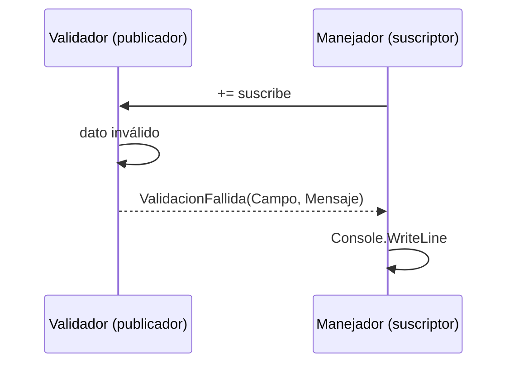
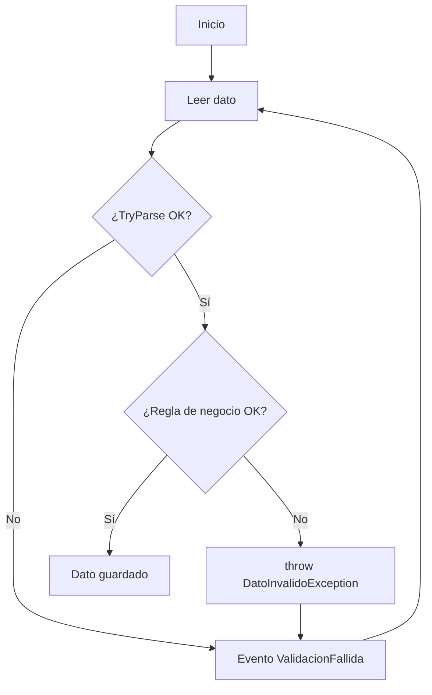

# Validación de datos en C#

Asignaciones, eventos y excepciones

<div class="pt-8 text-sm opacity-80">

**Tema 7.2** · Aplicación de consola (.NET 10)

</div>

<div class="abs-bottom m-6 text-sm opacity-70">
Aprendizaje esperado: prototipar un software que valide datos de entrada manejando asignaciones, eventos y excepciones.
</div>

<!--
[1 min] Da la bienvenida. Lee el aprendizaje esperado y pregunta:
"¿Alguna vez se les cayó un programa por escribir letras donde iba un número?"
-->

---

# Objetivo y agenda

Al terminar la sesión podrás **prototipar un programa de consola que valide datos de entrada**.

<v-clicks>

- 📝 Asignaciones: `TryParse`, setters, `??`, `??=`
- 📣 Eventos: `event`, `EventHandler`, `EventArgs`
- 🚨 Excepciones: `try/catch/finally`, `throw`
- 🧩 Caso práctico: Registro de Estudiantes
- ✅ Actividad de 5 minutos

</v-clicks>

<!--
[2 min] Muestra el mapa de la clase: 3 técnicas, 1 caso que las une y una actividad.
Aclara que todo se hará en consola con Console.WriteLine y Console.ReadLine.
-->

---
layout: two-cols
---

# ¿Por qué validar?

```csharp {1-3|all}
Console.Write("Edad: ");
// El usuario escribe "veinte"
int edad = int.Parse(Console.ReadLine()!);
```

<v-click>

💥 `System.FormatException`: el programa se cierra.

</v-click>

::right::

<div class="pl-6">

## Tipos de validación

<v-clicks>

- **Formato**: correo con `@`
- **Rango**: edad entre 15 y 100
- **Obligatoriedad**: no vacío
- **Longitud**: mínimo 3 letras
- **Lógica de negocio**: nota de 0 a 10

</v-clicks>

</div>

<!--
[2 min] Ejecuta mentalmente el ejemplo: el programa explota. Un dato malo no debe tumbar la aplicación.
Recorre los 5 tipos con un ejemplo cotidiano de cada uno.
-->

---
layout: section
---

# 1. Validación mediante asignaciones

Validar al momento de guardar el dato

<!-- [0.5 min] Idea clave: no asigno el valor hasta comprobar que es válido. -->

---
layout: two-cols
---

# Parse vs TryParse

### ❌ Parse

```csharp {1-2|all}
// Lanza excepción si falla
int edad = int.Parse("abc");
Console.WriteLine(edad);
```

<v-click>

El programa se cae.

</v-click>

::right::

<div class="pl-6">

### ✅ TryParse

```csharp {1|3-5|6-9|all}
string? texto = Console.ReadLine();

if (int.TryParse(texto, out int edad))
{
    Console.WriteLine($"Edad: {edad}");
}
else
{
    Console.WriteLine("Número inválido");
}
```

<v-click>

Devuelve `bool` y no lanza excepción. También existen `double.TryParse` y `DateTime.TryParse`.

</v-click>

</div>

<!--
[3 min] Pide que predigan qué pasa en cada lado. TryParse devuelve true/false y deja el valor en la variable out.
Menciona que double.TryParse depende de la cultura: "8,5" o "8.5".
-->

---

# Setters que validan, `??` y `??=`

```csharp {1-9|all}
public class Estudiante
{
    private int _edad;
    public int Edad
    {
        get => _edad;
        set => _edad = (value >= 15 && value <= 100)
            ? value
            : throw new ArgumentOutOfRangeException(nameof(value), "Edad fuera de rango");
    }
}
```

```csharp {1|2|3-4|all}
string? entrada = Console.ReadLine();
string nombre = entrada ?? "Sin nombre"; // si es null, usa el valor por defecto
int? nota = null;                         // tipo anulable
nota ??= 0;                               // asigna solo si es null
```

<!--
[3 min] El setter es la "puerta" de la propiedad: nadie guarda una edad inválida.
?? da un valor alternativo; ??= asigna solo si la variable es null; int? permite null en un entero.
-->

---
layout: section
---

# 2. Validación mediante eventos

El validador avisa, otro decide qué hacer

<!-- [0.5 min] Analogía: el validador "grita" que algo falló y quien esté escuchando reacciona. -->

---
layout: two-cols
---

# Evento `ValidacionFallida`

```csharp {1-6|all}
public class ValidacionEventArgs : EventArgs
{
    public string Campo { get; }
    public string Mensaje { get; }
    public ValidacionEventArgs(string c, string m)
    { Campo = c; Mensaje = m; }
}
```

```csharp {1-2|4-5|all}
public class Validador
{
    public event EventHandler<ValidacionEventArgs>?
        ValidacionFallida;
    public void Notificar(string c, string m) =>
        ValidacionFallida?.Invoke(this,
            new ValidacionEventArgs(c, m));
}
```

::right::

<div class="pl-4">

```csharp {all}
var validador = new Validador();

// Suscripción
validador.ValidacionFallida += (s, e) =>
    Console.WriteLine($"[{e.Campo}] {e.Mensaje}");

validador.Notificar("Edad", "Debe ser número");
```



</div>

<!--
[4 min] event = publicador; EventArgs lleva los datos; += suscribe un manejador.
El operador ?. evita error si nadie está suscrito. Sigue el diagrama de arriba hacia abajo.
-->

---
layout: section
---

# 3. Validación mediante excepciones

Cuando algo sale mal de verdad

<!-- [0.5 min] Las excepciones son para situaciones anormales, no para el flujo normal. -->

---

# `try` / `catch` / `finally` y `throw`

```csharp {1-3|4-5|6-7|8-9|10-11|all}
try
{
    int n = int.Parse(Console.ReadLine()!);   // puede fallar
}
catch (FormatException)   { Console.WriteLine("No es un número"); }
catch (OverflowException) { Console.WriteLine("Número demasiado grande"); }
catch (ArgumentNullException) { Console.WriteLine("Entrada nula"); }
finally
{
    Console.WriteLine("Fin de la validación"); // siempre se ejecuta
}
```

<v-clicks>

- `ArgumentException` / `ArgumentNullException`: argumentos inválidos
- `throw new ...` lanza una excepción propia en tu validación

</v-clicks>

<!--
[3 min] Orden: de la más específica a la más general. finally se ejecuta siempre (cerrar archivos, mostrar mensajes finales).
Muestra throw como la forma de decir "este dato no es aceptable".
-->

---
layout: two-cols
---

# Excepción personalizada

```csharp {1-8|all}
public class DatoInvalidoException : Exception
{
    public string Campo { get; }

    public DatoInvalidoException(string campo, string mensaje)
        : base(mensaje)
    { Campo = campo; }
}
```

```csharp {1-4|all}
if (string.IsNullOrWhiteSpace(nombre))
    throw new DatoInvalidoException(
        "Nombre", "El nombre es obligatorio");
```

::right::

<div class="pl-6">

## ¿TryParse o excepción?

<v-clicks>

- **TryParse**: errores *esperables* del usuario (letras en vez de números)
- **Excepción**: reglas de negocio o fallos inesperados
- No uses excepciones para controlar el flujo normal
- Captura solo lo que sabes manejar

</v-clicks>

</div>

<!--
[3 min] Una excepción propia da contexto (Campo) y hace el código más legible.
Regla práctica: si el error es frecuente y predecible, TryParse; si rompe una regla, excepción.
-->

---

# Comparativa de las tres técnicas

| Técnica | Ideal para | Ventaja | Cuidado |
|---|---|---|---|
| **Asignaciones** | Tipos y rangos simples | Simple y rápida | Mensajes poco detallados |
| **Eventos** | Notificar errores a otros componentes | Desacopla validador y vista | Requiere suscriptores |
| **Excepciones** | Reglas de negocio y fallos graves | Detiene el flujo con contexto | Costosas si se abusa |

<v-click>

<div class="mt-6 text-center text-lg">

💡 En un prototipo real **se combinan las tres**.

</div>

</v-click>

<!--
[3 min] Cada fila responde "¿cuándo la uso?". Cierra con la idea de que no compiten, se complementan.
Es la transición hacia el caso práctico.
-->

---

# Caso práctico: Registro de Estudiantes (1/3)

Nombre con **excepción**, aviso con **evento**

```csharp {1-4|5-9|10-12|all}
public string LeerNombre()
{
    while (true)
    {
        Console.Write("Nombre: ");
        string? entrada = Console.ReadLine();
        try
        {
            if (string.IsNullOrWhiteSpace(entrada))
                throw new DatoInvalidoException("Nombre", "Es obligatorio.");
            return entrada.Trim();
        }
        catch (DatoInvalidoException ex) { Notificar(ex.Campo, ex.Message); }
    }
}
```

<!--
[2 min] Bucle hasta que el dato sea válido. La excepción se lanza y se captura aquí mismo;
el catch convierte el error en un evento que avisa al usuario.
-->

---

# Caso práctico (2/3)

Edad y nota con **TryParse** + rango

```csharp {1-5|6-9|10-11|all}
public int LeerEdad()
{
    while (true)
    {
        Console.Write("Edad: ");
        if (!int.TryParse(Console.ReadLine(), out int edad))
        { Notificar("Edad", "Debe ser un número entero."); continue; }
        if (edad < 15 || edad > 100)
        { Notificar("Edad", "Debe estar entre 15 y 100."); continue; }
        return edad;
    }
}
```

<v-click>

`LeerNota()` es igual, con `double.TryParse` y rango 0 a 10. El código completo está en `Program.cs`.

</v-click>

<!--
[2 min] Primer filtro: tipo (TryParse). Segundo filtro: rango (lógica de negocio).
Si falla, se dispara el evento y se repite la pregunta.
-->

---
layout: two-cols
---

# Caso práctico (3/3): flujo y salida

```text {all}
=== Registro de Estudiantes ===
Nombre: Al
  ⚠ [Nombre] Mínimo 3 caracteres.
Nombre: Ana
Edad: veinte
  ⚠ [Edad] Debe ser un número entero.
Edad: 20
Correo: ana.mail.com
  ⚠ [Correo] Formato inválido.
Correo: ana@mail.com
Nota: 9.5
Estudiante registrado correctamente
```

::right::



<div class="mt-4 text-sm opacity-80">

💾 El código completo está en el archivo **Program.cs** que les voy a compartir.

</div>

<!--
[2 min] El diagrama resume las tres técnicas en un solo flujo. En la salida se ven los avisos del evento.
Aclara que el código completo está en Program.cs, que compartirás con ellos. Si puedes, ejecútalo en vivo 30 segundos.
-->

---

# Actividad práctica (5 min)

**Mini validador de contacto** en una app de consola

<v-clicks>

- Pedir **edad** (`int.TryParse`, rango 18 a 65)
- Pedir **correo** y lanzar `CorreoInvalidoException` si no contiene `@`
- Crear el evento `ValidacionFallida` y mostrar el error por consola
- Repetir cada pregunta hasta que el dato sea válido

</v-clicks>

<v-click>

| Criterio | Puntos |
|---|---|
| Usa `TryParse` y rango correctamente | 1 |
| Excepción personalizada lanzada y capturada | 1 |
| Evento declarado, suscrito y disparado | 1 |

</v-click>

<!--
[5 min] Trabajo individual o en parejas. Circula y revisa que el evento esté suscrito antes de usarse.
Quien termine puede agregar la nota de 0 a 10.
-->

---
layout: fact
---

# Resumen y buenas prácticas

<div class="text-base text-left mt-6 mx-auto max-w-xl">

- **Nunca confíes** en la entrada del usuario
- Prefiere `TryParse` para datos del usuario
- Eventos para **avisar**, excepciones para **romper reglas**
- Captura excepciones específicas, no `catch (Exception)` vacío
- Mensajes claros que digan qué corregir

</div>

<!--
[2 min] Recapitula las tres técnicas con una frase cada una.
Errores comunes: usar Parse sin proteger, catch vacío y olvidar suscribirse al evento.
-->

---

# Mini quiz y referencias

<v-clicks>

1. ¿Qué devuelve `int.TryParse` y qué ventaja tiene sobre `int.Parse`?
2. ¿Qué papel cumple `EventArgs` en un evento personalizado?
3. ¿Cuándo conviene lanzar una excepción propia en vez de usar `TryParse`?

</v-clicks>

<v-click>

### Referencias (Microsoft Learn)

- learn.microsoft.com/dotnet/csharp/fundamentals/coding-style
- learn.microsoft.com/dotnet/csharp/programming-guide/events
- learn.microsoft.com/dotnet/csharp/fundamentals/exceptions

</v-click>

<!--
[3 min] Pide respuestas orales rápidas. Deja las referencias como material de estudio y adelanta la próxima sesión.
-->